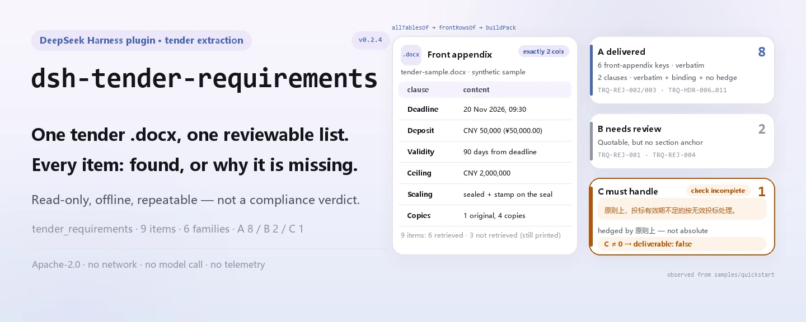

<div align="center">

<picture>
  <source media="(prefers-color-scheme: dark)" srcset="docs/assets/dsh-tender-requirements-hero-en-dark.webp">
  
</picture>

# dsh-tender-requirements

**Turn one tender document into a reviewable checklist — every item says what was retrieved and what is still missing.**

A local extractor for bid managers and tender agents: read the front appendix and body of a `.docx`, report the deadline, deposit, validity, ceiling, bid composition and copy counts, then pack them into the delivered / needs-confirmation / must-handle queues.

[Install](#three-step-setup) · [Configuration](#configuration) · [FAQ](#faq) · [简体中文](README.md) · [English](README.en.md) · [Español](README.es.md) · [Português](README.pt.md) · [हिन्दी](README.hi.md)

[](LICENSE)
[](#compatibility)
[](https://www.npmjs.com/package/dsh-tender-requirements)
[](https://github.com/PerryLink/dsh-tender-requirements/actions/workflows/ci.yml)
[](#compatibility)

[](https://github.com/PerryLink/dsh-tender-requirements/stargazers)
[](https://www.npmjs.com/package/dsh-tender-requirements)
[](https://dshfind.com/plugins/PerryLink/dsh-tender-requirements?ref=badge)
[](https://securityscorecards.dev/viewer/?uri=github.com/PerryLink/dsh-tender-requirements)

```sh
dsh plugin --profile <name> add dsh-tender-requirements
```

</div>

<sub>Community plugin, not affiliated with DeepSeek. Canonical repository: <https://github.com/PerryLink/dsh-tender-requirements>.</sub>

## What it is

`dsh-tender-requirements` is a read-only local extractor, not a reviewer. It opens the `.docx` you give it, pairs the rows of a two-column front appendix, then finds the bid-document composition list and copy counts in the body, and finally emits a report with provenance, confidence and a reason for every item. Items that were not found are printed too, and they say "not retrieved" rather than "the document does not say". No model call, no network request and no second copy of the data.

<picture>
  <source media="(prefers-color-scheme: dark)" srcset="docs/assets/dsh-tender-requirements-flow-v5-dark.svg">
  
</picture>

## Three-step setup

1. **Install** (npm channel; git and tarball also work):

   ```sh
   # npm channel (0.2.4 is published)
   dsh plugin --profile web add dsh-tender-requirements
   # git channel (latest main)
   dsh plugin --profile web add github:PerryLink/dsh-tender-requirements
   # tarball channel: pnpm pack in this repo, then
   dsh plugin --profile web add ./dsh-tender-requirements-0.2.4.tgz
   ```

   The profile inserts a `dsh-tender-requirements` row through `cordis.patch.yml`; the tool is named `tender_requirements`.

2. **Minimal config** (defaults work; only the timeout budget needs tuning):

   ```yaml
   - insert:
       - id: dsh-tender-requirements
         name: dsh-tender-requirements
         config:
           timeoutMs: 120000
   ```

3. **Verify it mounts**:

   ```sh
   dsh --profile web --dump-config | grep 'dsh-tender-requirements'
   pnpm run build && node samples/quickstart/run.mjs --check
   ```

   ```
   tender_requirements: quickstart OK — output matches expected/result.json
   ```

   In a session you can also call `tender_requirements` with `file` pointing at a `.docx`.

**Uninstall**: `dsh plugin --profile web remove dsh-tender-requirements` (or remove the row from the profile patch).

## Core capabilities

It separates extraction from adjudication: every result is what the document says, never a compliance verdict.

Rejection clauses do not rely on one keyword table: the spec's controlled comparison found that a result-words-only list (words such as "invalid" or "rejected") hit 12/24 on constructed data with two false positives, while a trigger-words-only list (words such as "must not", "shall" or "must") hit 15/24, over half of which were the buyer's own obligations. That is why recognition is split into six wording families.

- **Nine items, each reported** — bid deadline, opening time, bid security, bid validity, ceiling, copy counts, sealing requirements, site visit and clarification deadline. Each carries `value`, `source`, `confidence` and `reason`; a miss still gets a row explaining why.
- **Two-column front appendix first** — only a table with exactly two columns is treated as the front appendix; a key/value hit there earns high confidence. A keyword hit in body text drops to medium and says the wording may not be final.
- **Composition list and copy counts** — entries are read after a lead-in such as "composition of the bid document", must be consecutively numbered and at least three long; copy counts accept both Chinese and Arabic numerals, including the written-out comma-separated form that a plain digit regex misses.
- **RequirementsPack with three queues** — rejection clauses are grouped into six families (`refuse` / `invalid` / `reject` / `disqualify` / `deviation` / `postAward`) and sorted into A delivered, B needs confirmation and C must handle; while C is non-empty, `deliverable: false` and the report says the check is unfinished.
- **Ten-topic coverage net** — COV-01…COV-10 each report hit or not retrieved; a miss is not proof that the document omits the topic.
- **Local and repeatable** — no model call, no network request, no telemetry; the same `.docx` yields the same result every time.

### Tool and result surface

| Surface | Meaning |
|---|---|
| `tender_requirements` tool | The only entry point; `file` is an absolute `.docx` path |
| `mode: requirements` | Default; returns the three-queue pack, markdown and machine-readable JSON |
| `mode: extract` | Returns only the front appendix and composition list, without queues |
| `markdown` | Report for a human or a model to read |
| `resultJson` / `requirementsPack` | Machine-readable extraction / RequirementsPack |

### Examples

The output below comes from the synthetic sample in this repository; run `pnpm run build`, then `node samples/quickstart/run.mjs`.

```text
$ node samples/quickstart/run.mjs
tender_requirements: 6 found, 3 missing, 6 composition item(s) — deliverable false
queues: a=8 b=2 c=1
```

*Observed from `samples/quickstart/run.mjs`; `docs/assets/quickstart.log`; `samples/quickstart/expected/result.json`*

`--check` compares those six fields byte for byte with `expected/result.json`; `--json` prints the same summary as JSON. A terminal screenshot is at [`docs/assets/quickstart.png`](docs/assets/quickstart.png).

**Failure path** — when the file is not a `.docx` or contains no readable table, extraction fails closed with a `TenderError` that names the file and says the front appendix is usually a two-column table (`src/model.ts:267`). A missing `file` argument fails before any read with an explicit message (`src/index.ts:85`).

### How the three queues split

| Queue | Meaning | Entry condition |
|---|---|---|
| A delivered | Quoted verbatim, in a binding section, no hedge | Six-family keyword hit + a section such as bidder instructions or evaluation method, with no hedge word |
| B needs confirmation | The quote exists, but structural evidence is weak | Six-family keyword hit outside a binding section |
| C must handle | Not extractable, or not an absolute statement | A hedge such as "in principle", "generally", "may", "as appropriate", "if necessary" or "at discretion", or no verbatim match |

`deliverable` is `true` only when C is empty; the queues are three strengths of evidence, not three priorities.

## Standards it follows

The package does not cite a clause as the basis of a finding — it extracts, it does not check. What it encodes is the structure the clauses imply:

- Article 20 of the Government Procurement Measures for Tender of Goods and Services (Order 87) lists the 16 items a tender document must contain, including evaluation method, evaluation criteria and invalid-bid situations — which is why the front appendix is the information hub.
- Article 23 of the Tendering and Bidding Law: a clarification, amendment or Q&A minute **is part of the tender document**. This package reads the main document only; that is the known systematic source of missed requirements.

`rules/tender-requirements.yaml` is the rule-pack locator, and `rules: []` means there are no executable rules; because nothing here cites a clause as the basis of a finding, there is no `rules/evidence/` directory.

## Material format

The input must be a `.docx`. Tables are read one candidate at a time through `dsh-table-ingest` — the front appendix is not necessarily the first table, so taking only the default table is not enough. Paragraphs come from the same reader, and the composition list is looked up only in paragraphs.

A front appendix is recognised as a table with **exactly two columns**. If the header detector has chosen a data pair as the header (its second cell looks like a date, an amount or a count), that pair is recovered as a row — otherwise a plainly stated deadline would be silently missing.

The tool reads text and tables inside the `.docx`; it does not parse scans or images, and it does no OCR. With no readable table it throws a `TenderError`.

## Configuration

There is only one tunable, the tool timeout; there is no rule-file switch.

| Key | Default | Meaning |
|---|---|---|
| `timeoutMs` | `120000` | Timeout budget for the `tender_requirements` tool in milliseconds; the host aborts the run on timeout |

<details>
<summary>Full configuration table (1 key)</summary>

| Key | Default | Meaning |
|---|---|---|
| `timeoutMs` | `120000` | Timeout budget for the `tender_requirements` tool in milliseconds; the host aborts the run on timeout |

There are no other tunables; the rule-pack path is a fixed packaged resource, not a config key.

</details>

Profile patch override:

```yaml
- insert:
    - id: dsh-tender-requirements
      name: dsh-tender-requirements
      config:
        timeoutMs: 300000
```

Overriding by id replaces the whole row — restate every key you need.

## FAQ

<details>
<summary>Is the document uploaded or retained?</summary>

No. The plugin is local and read-only: it reads bytes from the `.docx` you pass, makes no network request, makes no model call and writes no second copy. The tool result does enter the DSH host's own session log (that is host behaviour); if the document contains sensitive information, manage that log the way you normally do.

</details>

<details>
<summary>Does "not retrieved" mean the tender document does not contain the item?</summary>

No. "Not retrieved" only means this run did not match the item in a front-appendix key or a body paragraph. Different wording, a table cell or an amendment can all be missed. The report asks for human review.

</details>

<details>
<summary>What does "finished only when C is empty" mean?</summary>

C holds clauses the tool could not extract or that are not absolute statements. While C is non-empty, `deliverable` is `false` and the report header says the check is unfinished. Merge C by hand and re-run before calling the pack complete. A single merged list would let a tool say "no problems" when it only found the quotable part — which is exactly what the three queues prevent.

</details>

<details>
<summary>Will it conflict with other plugins?</summary>

It registers one namespaced tool, `tender_requirements`, and injects only `tools`. It registers no service key, listens to no session event, registers no client slot, registers no HTTP route and mutates no global object. `dsh-table-ingest` is used as a library, not as an extra plugin row.

</details>

<details>
<summary>Is a large document slow?</summary>

There is no model call; time goes into unzipping the `.docx` and reading tables one by one, and `dsh-table-ingest` has entry-count and output budgets. The default timeout is 120 seconds and can be changed with `timeoutMs`.

</details>

## Troubleshooting

- **It installs but the tool never appears**: check that `main` resolves to `lib/index.mjs` and that `pnpm run build` produced `lib/` (build output is not committed).
- **`dsh plugin add` rejects the package**: the host line must fall within `>=0.2.1-0 <0.3.0`; outside that range, grant an explicit exemption instead of force-installing an older core.
- **An item never gets extracted**: check whether the matching `coverage.topics` entry is `hit: false`, and read `notes`; for a front appendix, confirm it is exactly a two-column table.
- **It reports no readable table**: the file may not be a `.docx`, or the front appendix may not be a table; this tool performs no OCR on scans.
- **The old `skipped` array**: that belongs to the rule-checker family; this package is an extractor and produces no `skipped` array — the equivalent information is in `coverage.topics` and `notes`.

## Security boundaries

- **Read-only and offline.** It reads only the `.docx` passed in, makes no network request, makes no model call and writes no data outside the package; there is no telemetry, analytics or background reporting.
- **Extraction is not adjudication.** The output says "the document states this", not "this is legally valid" or "this bid will win"; it does not judge compliance or liability.
- **Not retrieved does not mean absent.** Every miss carries a reason; the report never turns a gap into a negative finding.
- **Fails closed.** With no readable table it throws instead of returning an empty success; when paragraphs cannot be read it warns that only table extraction ran.
- **Session-log boundary.** Tool return values (including quotes and file paths) enter the DSH host's own session/log storage; this package adds no copy, but it does not control the host's retention policy.

## Permissions & data

- **Permissions**: `dsh.capabilities` declares only `tools:register`; the plugin reads the `.docx` you name and hands the result to the host.
- **Data**: it writes no second file, creates no database and makes no network request; uninstalling removes code only and does not delete host session logs or documents you already created.
- **Privacy**: the statement in `PRIVACY.md` covers the npm package, not the DSH host or other plugins in the profile.

## Known limitations

- **Main document only.** Clarifications, amendments, addenda and Q&A minutes are part of the tender document by law (Tendering and Bidding Law, Article 23), and this tool does not merge them; merge them by hand before judging. This is the largest systematic source of missed requirements.
- **The front appendix must be a two-column table.** Three-column, merged-cell or image-based front appendices are not recognised; key values then fall back to body-text hits (medium confidence) or to "not retrieved".
- **The composition list has structural requirements.** It must start after a lead-in such as "composition of the bid document" and contain at least three consecutively numbered entries; a numbering jump ends the list.
- **Copy counts only match the Chinese labels for original and duplicate, followed by a count and the measure word.** Chinese and Arabic numerals both work, but shorthand such as "one original, four copies" in a different form is not parsed; when neither count parses, the report says to check by hand.
- **Rejection clauses are scanned in body paragraphs only.** Wording outside the six families (`refuse` / `invalid` / `reject` / `disqualify` / `deviation` / `postAward`) is not classified; a rejection clause written in a table does not enter the queues either.
- **The coverage net is keyword-based.** COV-01…COV-10 only say whether related wording was found; this is not a legal completeness check, and every miss needs human confirmation.
- **A body hit takes the first paragraph.** When a keyword appears in several paragraphs, the first match is cut to 200 characters and may not be the final wording.
- **No scanned documents.** The input must be a `.docx` with text or tables; PDF, images and OCR are out of scope.
- **No evidence directory.** Nothing here cites a clause as the basis of a finding, so `rules/evidence/` is not maintained; `rules: []` in `rules/tender-requirements.yaml` is intentional.

## Interoperability with other DSH plugins

Checked against this repository's plugin contract and dependency surface; the conclusion is that it occupies none of the surfaces other plugins share:

- **No tool-name conflict.** It registers only `tender_requirements`, a name in this package's namespace, and takes no bare name owned by a built-in tool.
- **No service-key conflict.** It provides no service and only consumes `tools`.
- **No event listener.** It subscribes to no session event such as `agent/*` or `tools/*`, so there is no listener ordering or short-circuit question.
- **No slot or HTTP route.** It has no browser half, registers no client slot and no `webServer` prefix.
- **No global rewrite.** It does not touch prototypes, `process.env` or global objects; `dsh-table-ingest` is imported as a library.
- **Patch boundary.** `cordis.patch.yml` only `insert`s its own row and never overwrites another row's `config`.

Static evidence: `pnpm run verify:self-contained` and `pnpm run check:lockfile` run in CI; dependency specs come from the registry.

## Compatibility

| Dimension | Status |
|---|---|
| Harness | `>=0.2.1-0 <0.3.0` (package.json `engines.dsh`); the `@deepseek-ai/dsh-tools` peer covers `>=0.1.2-rc.1 <0.2.0 \|\| >=0.2.0-0 <0.3.0` |
| Node | `^22.19.0 \|\| >=24.0.0` |
| Platforms | anywhere DSH runs (pure ESM; no native code, no network, no model call) |
| Model | no model capability needed; extraction is fully local |
| Input | `.docx` (text and tables; no OCR) |

## Ecosystem & quality

- [npm package](https://www.npmjs.com/package/dsh-tender-requirements) (0.2.4)
- [dshfind plugin page](https://dshfind.com/plugins/PerryLink/dsh-tender-requirements) (installs and ranking)
- [OpenSSF Scorecard report](https://securityscorecards.dev/viewer/?uri=github.com/PerryLink/dsh-tender-requirements) (driven by [.github/workflows/scorecard.yml](.github/workflows/scorecard.yml))
- **Quality gates**: `typecheck` · `vitest` (extraction, queues, boundary semantics and version sync) · `verify:self-contained` · `check:lockfile` · `check:readmes` · `check:citations`, all in CI
- **Synthetic sample**: `samples/quickstart/` ships the input `.docx`, the expected result and a repeatable script

## Development

```sh
pnpm install
pnpm run typecheck
pnpm test
pnpm run build
pnpm run verify:self-contained
pnpm run check:lockfile
pnpm run check:readmes
pnpm run check:citations
pnpm pack
node samples/quickstart/run.mjs --check   # after build
```

Directory layout:

| Path | Contents |
|---|---|
| `src/index.ts` | Plugin entry: registers the `tender_requirements` tool, reads the `.docx`, assembles the result |
| `src/model.ts` | Extraction core: front appendix, nine items, composition list, copy counts, coverage |
| `src/requirements.ts` | RequirementsPack: six rejection families, A/B/C queues, ten-topic coverage net |
| `src/report.ts` / `src/pack-report.ts` | Human-readable markdown |
| `src/config.ts` | Schemastery config (`timeoutMs`) |
| `src/shared/` | Family shared kit (copied in, not an extra dependency) |
| `rules/tender-requirements.yaml` | Rule-pack locator (`rules: []`) |
| `samples/quickstart/` | Repeatable synthetic sample |
| `tests/` | vitest suites and the `.docx` fixture |
| `scripts/` | Mechanical gates and the asset generator |

Images are generated programmatically by [`scripts/gen-readme-assets.py`](scripts/gen-readme-assets.py): Python + Pillow for the light/dark hero WebP files and hand-written light/dark structure SVGs (names start with `dsh-tender-requirements-`). Re-run with `python scripts/gen-readme-assets.py`.

Shared-code sync: `src/shared/` is copied from the family shared kit; inside the family workspace it can be refreshed with `node ../scripts/sync-shared.mjs dsh-tender-requirements` (that script does not exist in a standalone clone).

Topics: `dsh`, `dsh-plugin`, `deepseek-harness`, `deepseek`, `cordis`, `tender`, `extraction`, `bid`, `requirements`

## Family & thanks

This project is a member of the DeepSeek Harness plugin family maintained by [PerryLink](https://github.com/PerryLink) (all Apache-2.0). Full family index: [choose a checker by material](https://perrylink.github.io/zh/checkers/choose/); every plugin is listed below. If it helped you, **give it a star** — it unlocks nothing, but it makes the next person more likely to find it.

- [@PerryLink](https://github.com/PerryLink) — creator and maintainer: the extractor, the three-queue RequirementsPack, the ten-topic coverage net and the five-language docs.

<details>
<summary>Expand all plugins</summary>

| Plugin | Status |
|---|---|
| **[dsh-aqua-input-check](https://github.com/PerryLink/dsh-aqua-input-check)** |  |
| **[dsh-archive-check](https://github.com/PerryLink/dsh-archive-check)** |  |
| **[dsh-auto-review](https://github.com/PerryLink/dsh-auto-review)** |  |
| **[dsh-autotier](https://github.com/PerryLink/dsh-autotier)** | 🧊 FROZEN — see the repo README |
| **[dsh-bid-ca-precheck](https://github.com/PerryLink/dsh-bid-ca-precheck)** |  |
| **[dsh-bid-qual-check](https://github.com/PerryLink/dsh-bid-qual-check)** |  |
| **[dsh-cert-mcp](https://github.com/PerryLink/dsh-cert-mcp)** | 🧊 FROZEN — see the repo README |
| **[dsh-checkpoint-rewind](https://github.com/PerryLink/dsh-checkpoint-rewind)** |  |
| **[dsh-click](https://github.com/PerryLink/dsh-click)** |  |
| **[dsh-composer-history](https://github.com/PerryLink/dsh-composer-history)** |  |
| **[dsh-contract-stance](https://github.com/PerryLink/dsh-contract-stance)** |  |
| **[dsh-customs-doc-check](https://github.com/PerryLink/dsh-customs-doc-check)** |  |
| **[dsh-data-quality](https://github.com/PerryLink/dsh-data-quality)** | 🧊 FROZEN — see the repo README |
| **[dsh-demurrage-ledger](https://github.com/PerryLink/dsh-demurrage-ledger)** |  |
| **[dsh-doublecheck](https://github.com/PerryLink/dsh-doublecheck)** |  |
| **[dsh-drill-script-check](https://github.com/PerryLink/dsh-drill-script-check)** |  |
| **[dsh-eia-guide-check](https://github.com/PerryLink/dsh-eia-guide-check)** |  |
| **[dsh-emergency-plan](https://github.com/PerryLink/dsh-emergency-plan)** |  |
| **[dsh-essay-rubric-check](https://github.com/PerryLink/dsh-essay-rubric-check)** |  |
| **[dsh-evidence-check](https://github.com/PerryLink/dsh-evidence-check)** |  |
| **[dsh-export-ctl-check](https://github.com/PerryLink/dsh-export-ctl-check)** |  |
| **[dsh-fast](https://github.com/PerryLink/dsh-fast)** |  |
| **[dsh-fmea-table-check](https://github.com/PerryLink/dsh-fmea-table-check)** |  |
| **[dsh-forecast-penalty](https://github.com/PerryLink/dsh-forecast-penalty)** |  |
| **[dsh-fund-research](https://github.com/PerryLink/dsh-fund-research)** |  |
| **[dsh-github](https://github.com/PerryLink/dsh-github)** |  |
| **[dsh-gongwen-flow-check](https://github.com/PerryLink/dsh-gongwen-flow-check)** |  |
| **[dsh-gongwen-word-check](https://github.com/PerryLink/dsh-gongwen-word-check)** |  |
| **[dsh-guard-plan-qc](https://github.com/PerryLink/dsh-guard-plan-qc)** |  |
| **[dsh-hazchem-check](https://github.com/PerryLink/dsh-hazchem-check)** |  |
| **[dsh-hazplan-check](https://github.com/PerryLink/dsh-hazplan-check)** |  |
| **[dsh-hidden-risk-map](https://github.com/PerryLink/dsh-hidden-risk-map)** |  |
| **[dsh-hs-classify](https://github.com/PerryLink/dsh-hs-classify)** |  |
| **[dsh-icd-rule-check](https://github.com/PerryLink/dsh-icd-rule-check)** |  |
| **[dsh-industry-research](https://github.com/PerryLink/dsh-industry-research)** |  |
| **[dsh-lawcite-adapter](https://github.com/PerryLink/dsh-lawcite-adapter)** |  |
| **[dsh-laya](https://github.com/PerryLink/dsh-laya)** |  |
| **[dsh-lc-doc-check](https://github.com/PerryLink/dsh-lc-doc-check)** |  |
| **[dsh-learning-gap-check](https://github.com/PerryLink/dsh-learning-gap-check)** |  |
| **[dsh-library](https://github.com/PerryLink/dsh-library)** |  |
| **[dsh-local-ai](https://github.com/PerryLink/dsh-local-ai)** |  |
| **[dsh-lsp-actions](https://github.com/PerryLink/dsh-lsp-actions)** |  |
| **[dsh-mask](https://github.com/PerryLink/dsh-mask)** |  |
| **[dsh-mcp-panel](https://github.com/PerryLink/dsh-mcp-panel)** |  |
| **[dsh-medrec-qc](https://github.com/PerryLink/dsh-medrec-qc)** |  |
| **[dsh-memento](https://github.com/PerryLink/dsh-memento)** | 🧊 FROZEN — see the repo README |
| **[dsh-nsfc-form-check](https://github.com/PerryLink/dsh-nsfc-form-check)** |  |
| **[dsh-nurse-record-check](https://github.com/PerryLink/dsh-nurse-record-check)** |  |
| **[dsh-observe](https://github.com/PerryLink/dsh-observe)** |  |
| **[dsh-origin-rvc-check](https://github.com/PerryLink/dsh-origin-rvc-check)** |  |
| **[dsh-ota-review-check](https://github.com/PerryLink/dsh-ota-review-check)** |  |
| **[dsh-output-styles](https://github.com/PerryLink/dsh-output-styles)** |  |
| **[dsh-paper-doc-adapter](https://github.com/PerryLink/dsh-paper-doc-adapter)** |  |
| **[dsh-permission-rules](https://github.com/PerryLink/dsh-permission-rules)** |  |
| **[dsh-permit-report-check](https://github.com/PerryLink/dsh-permit-report-check)** |  |
| **[dsh-pipeline-check](https://github.com/PerryLink/dsh-pipeline-check)** |  |
| **[dsh-pleading-draft](https://github.com/PerryLink/dsh-pleading-draft)** |  |
| **[dsh-plugin-doctor](https://github.com/PerryLink/dsh-plugin-doctor)** | 🚫 RETIRED (repo archived) |
| **[dsh-plugin-guide](https://github.com/PerryLink/dsh-plugin-guide)** |  |
| **[dsh-plugin-kit](https://github.com/PerryLink/dsh-plugin-kit)** | 🚫 RETIRED (repo archived) |
| **[dsh-plugin-upgrade](https://github.com/PerryLink/dsh-plugin-upgrade)** | 🚫 RETIRED (repo archived) |
| **[dsh-policy-brief-draft](https://github.com/PerryLink/dsh-policy-brief-draft)** |  |
| **[dsh-power-loss-split](https://github.com/PerryLink/dsh-power-loss-split)** |  |
| **[dsh-power-ticket-check](https://github.com/PerryLink/dsh-power-ticket-check)** |  |
| **[dsh-ppap-check](https://github.com/PerryLink/dsh-ppap-check)** |  |
| **[dsh-protest-deadline](https://github.com/PerryLink/dsh-protest-deadline)** |  |
| **[dsh-railway-window](https://github.com/PerryLink/dsh-railway-window)** |  |
| **[dsh-repair-order-qc](https://github.com/PerryLink/dsh-repair-order-qc)** |  |
| **[dsh-research-report](https://github.com/PerryLink/dsh-research-report)** |  |
| **[dsh-review-reply-check](https://github.com/PerryLink/dsh-review-reply-check)** |  |
| **[dsh-rulefile-check](https://github.com/PerryLink/dsh-rulefile-check)** |  |
| **[dsh-safety-brief-check](https://github.com/PerryLink/dsh-safety-brief-check)** |  |
| **[dsh-score](https://github.com/PerryLink/dsh-score)** | 🧊 FROZEN — see the repo README |
| **[dsh-session-sync](https://github.com/PerryLink/dsh-session-sync)** |  |
| **[dsh-site-log-check](https://github.com/PerryLink/dsh-site-log-check)** |  |
| **[dsh-skill-pack-security](https://github.com/PerryLink/dsh-skill-pack-security)** |  |
| **[dsh-soe-decision-check](https://github.com/PerryLink/dsh-soe-decision-check)** |  |
| **[dsh-soilwater-check](https://github.com/PerryLink/dsh-soilwater-check)** |  |
| **[dsh-sop-sync-check](https://github.com/PerryLink/dsh-sop-sync-check)** |  |
| **[dsh-spc-gbt-adapter](https://github.com/PerryLink/dsh-spc-gbt-adapter)** |  |
| **[dsh-talk](https://github.com/PerryLink/dsh-talk)** |  |
| **[dsh-tender-extract](https://github.com/PerryLink/dsh-tender-extract)** |  |
| **[dsh-tender-matrix](https://github.com/PerryLink/dsh-tender-matrix)** |  |
| **[dsh-test-drive](https://github.com/PerryLink/dsh-test-drive)** |  |
| **[dsh-ticktick](https://github.com/PerryLink/dsh-ticktick)** | 🚫 RETIRED (repo archived) |
| **[dsh-translate](https://github.com/PerryLink/dsh-translate)** |  |
| **[dsh-warranty-calc](https://github.com/PerryLink/dsh-warranty-calc)** |  |
| **[dsh-budget](https://github.com/PerryLink/dsh-budget)** | 🧊 FROZEN — see the repo README |
| **[dsh-claude-move](https://github.com/PerryLink/dsh-claude-move)** | 🧊 FROZEN — see the repo README |
| **[dsh-defend](https://github.com/PerryLink/dsh-defend)** | 🧊 FROZEN — see the repo README |
| **[dsh-draw](https://github.com/PerryLink/dsh-draw)** | 🧊 FROZEN — see the repo README |
| **[dsh-reach](https://github.com/PerryLink/dsh-reach)** | 🧊 FROZEN — see the repo README |
| **[dsh-background-agents](https://github.com/PerryLink/dsh-background-agents)** | 🚫 RETIRED (repo archived) |
| **[dsh-session-pin](https://github.com/PerryLink/dsh-session-pin)** | 🚫 RETIRED (repo archived) |
| **[dsh-team-rooms](https://github.com/PerryLink/dsh-team-rooms)** | 🚫 RETIRED (repo archived) |

</details>

## License

[LICENSE](LICENSE) (Apache License 2.0) © 2026 dsh-tender-requirements contributors

<p align="center"><sub>Apache-2.0 · Community plugin, not affiliated with DeepSeek.</sub></p>
