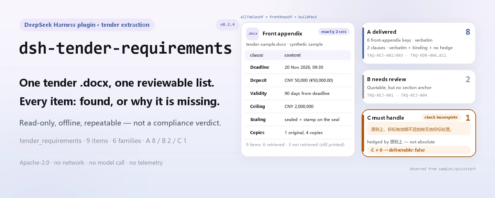

<div align="center">

<picture>
  <source media="(prefers-color-scheme: dark)" srcset="docs/assets/dsh-tender-requirements-hero-en-dark.webp">
  
</picture>

# dsh-tender-requirements

**Convierte un pliego de licitación en una lista de puntos revisable: cada elemento dice qué se recuperó y qué falta.**

Un extractor local para responsables de ofertas y agentes de licitación: lee el anexo inicial y el cuerpo de un `.docx`, informa de plazo, garantía, validez, techo, composición de la oferta y número de originales y copias, y lo empaqueta en las colas de entregado / por confirmar / a resolver.

[Instalar](#instalación-en-tres-pasos) · [Configuración](#configuración) · [FAQ](#faq) · [简体中文](README.md) · [English](README.en.md) · [Español](README.es.md) · [Português](README.pt.md) · [हिन्दी](README.hi.md)

[](LICENSE)
[](#compatibilidad)
[](https://www.npmjs.com/package/dsh-tender-requirements)
[](https://github.com/PerryLink/dsh-tender-requirements/actions/workflows/ci.yml)
[](#compatibilidad)

[](https://github.com/PerryLink/dsh-tender-requirements/stargazers)
[](https://www.npmjs.com/package/dsh-tender-requirements)
[](https://dshfind.com/plugins/PerryLink/dsh-tender-requirements?ref=badge)
[](https://securityscorecards.dev/viewer/?uri=github.com/PerryLink/dsh-tender-requirements)

```sh
dsh plugin --profile <name> add dsh-tender-requirements
```

</div>

<sub>Plugin de la comunidad, no afiliado a DeepSeek. Repositorio canónico: <https://github.com/PerryLink/dsh-tender-requirements>.</sub>

## Qué es

`dsh-tender-requirements` es un extractor local de solo lectura, no un revisor. Abre el `.docx` que le das, empareja las filas de un anexo inicial de dos columnas, busca después la lista de composición de la oferta y el número de copias en el cuerpo, y por último emite un informe con procedencia, confianza y motivo para cada elemento. Los elementos no encontrados también se imprimen, y dicen «no recuperado» en lugar de «el pliego no lo dice». Sin llamadas al modelo, sin red y sin una segunda copia de los datos.

<picture>
  <source media="(prefers-color-scheme: dark)" srcset="docs/assets/dsh-tender-requirements-flow-v5-dark.svg">
  
</picture>

## Instalación en tres pasos

1. **Instala** (canal npm; también valen git y tarball):

   ```sh
   # canal npm (0.2.4 publicada)
   dsh plugin --profile web add dsh-tender-requirements
   # canal git (última main)
   dsh plugin --profile web add github:PerryLink/dsh-tender-requirements
   # canal tarball: tras pnpm pack en este repo
   dsh plugin --profile web add ./dsh-tender-requirements-0.2.4.tgz
   ```

   El perfil inserta una fila `dsh-tender-requirements` mediante `cordis.patch.yml`; la herramienta se llama `tender_requirements`.

2. **Configuración mínima** (los valores por defecto sirven; solo hay que ajustar el tiempo límite):

   ```yaml
   - insert:
       - id: dsh-tender-requirements
         name: dsh-tender-requirements
         config:
           timeoutMs: 120000
   ```

3. **Comprueba que se monta**:

   ```sh
   dsh --profile web --dump-config | grep 'dsh-tender-requirements'
   pnpm run build && node samples/quickstart/run.mjs --check
   ```

   ```
   tender_requirements: quickstart OK — output matches expected/result.json
   ```

   En una sesión también puedes llamar a `tender_requirements` con `file` apuntando a un `.docx`.

**Desinstalar**: `dsh plugin --profile web remove dsh-tender-requirements` (o elimina la fila del patch del perfil).

## Capacidades clave

Separa la extracción del juicio: cada resultado es lo que dice el documento, nunca un veredicto de cumplimiento.

Las cláusulas de rechazo no dependen de una única tabla de palabras clave: la comparación controlada de la especificación mostró que una lista solo de palabras de resultado (como «inválida» o «rechazada») acertó 12/24 sobre datos construidos, con dos falsos positivos, mientras que una lista solo de palabras desencadenantes (como «no debe», «deberá» o «debe») acertó 15/24, y más de la mitad eran obligaciones del propio comprador. Por eso el reconocimiento se divide en seis familias de redacción.

- **Nueve elementos, todos informados** — plazo de presentación, apertura, garantía, validez de la oferta, techo, número de copias, requisitos de sellado, visita al sitio y plazo de aclaraciones. Cada uno lleva `value`, `source`, `confidence` y `reason`; un fallo también deja una fila con su motivo.
- **Primero el anexo inicial de dos columnas** — solo se trata como anexo inicial una tabla con exactamente dos columnas; un acierto clave/valor allí obtiene confianza alta. Un acierto por palabra clave en el cuerpo baja a media y avisa de que la redacción puede no ser la definitiva.
- **Lista de composición y número de copias** — las entradas se leen tras una frase guía como «composición del documento de la oferta», deben ir numeradas de forma consecutiva y ser al menos tres; el número de copias acepta numerales chinos y árabes, incluida la forma escrita separada por comas que un regex de dígitos pasa por alto.
- **RequirementsPack con tres colas** — las cláusulas de rechazo se agrupan en seis familias (`refuse` / `invalid` / `reject` / `disqualify` / `deviation` / `postAward`) y se reparten en A entregado, B por confirmar y C a resolver; mientras C no esté vacía, `deliverable: false` y el informe dice que la revisión está incompleta.
- **Red de cobertura de diez temas** — COV-01…COV-10 informan de acierto o no recuperado; un fallo no demuestra que el pliego omita el tema.
- **Local y repetible** — sin llamadas al modelo, sin red y sin telemetría; el mismo `.docx` da siempre el mismo resultado.

### Superficie de herramienta y resultado

| Superficie | Significado |
|---|---|
| Herramienta `tender_requirements` | Única entrada; `file` es una ruta absoluta a un `.docx` |
| `mode: requirements` | Por defecto; devuelve el pack de tres colas, markdown y JSON legible por máquina |
| `mode: extract` | Devuelve solo el anexo inicial y la lista de composición, sin colas |
| `markdown` | Informe para que lo lea una persona o un modelo |
| `resultJson` / `requirementsPack` | Extracción / RequirementsPack legibles por máquina |

### Ejemplos

La salida siguiente procede de la muestra sintética del repositorio; ejecuta `pnpm run build` y luego `node samples/quickstart/run.mjs`.

```text
$ node samples/quickstart/run.mjs
tender_requirements: 6 found, 3 missing, 6 composition item(s) — deliverable false
queues: a=8 b=2 c=1
```

*Observed from `samples/quickstart/run.mjs`; `docs/assets/quickstart.log`; `samples/quickstart/expected/result.json`*

`--check` compara esos seis campos byte a byte con `expected/result.json`; `--json` imprime el mismo resumen como JSON. Hay una captura de terminal en [`docs/assets/quickstart.png`](docs/assets/quickstart.png).

**Rama de fallo** — si el archivo no es un `.docx` o no contiene ninguna tabla legible, la extracción falla en cerrado con un `TenderError` que nombra el archivo y dice que el anexo inicial suele ser una tabla de dos columnas (`src/model.ts:267`). Si falta el argumento `file`, falla antes de leer nada con un mensaje explícito (`src/index.ts:85`).

### Cómo se reparten las tres colas

| Cola | Significado | Condición de entrada |
|---|---|---|
| A entregado | Citado literalmente, en una sección vinculante, sin matices | Acierto de una de las seis familias + una sección como instrucciones a licitadores o método de evaluación, sin palabra de matiz |
| B por confirmar | La cita existe, pero la evidencia estructural es débil | Acierto de una de las seis familias fuera de una sección vinculante |
| C a resolver | No extraíble o no es una afirmación absoluta | Un matiz como «en principio», «generalmente», «puede», «según el caso», «si es necesario» o «a discreción», o falta de coincidencia literal |

`deliverable` es `true` solo cuando C está vacía; las colas son tres fuerzas de evidencia, no tres prioridades.

## Normas que sigue

El paquete no cita cláusulas como base de una comprobación porque extrae, no comprueba. Codifica la estructura que las cláusulas implican:

- El artículo 20 de las Medidas de Contratación Pública de Bienes y Servicios (Orden 87) enumera los 16 elementos que debe contener un pliego, incluidos método, criterios de evaluación y supuestos de oferta inválida; por eso el anexo inicial es el centro de información.
- El artículo 23 de la Ley de Licitaciones: una aclaración, modificación o acta de preguntas **es parte del pliego**. Este paquete lee solo el documento principal; esa es la fuente sistemática conocida de requisitos omitidos.

`rules/tender-requirements.yaml` es el localizador del paquete de reglas, y `rules: []` significa que no hay reglas ejecutables; como nada aquí cita una cláusula como base de un hallazgo, no se mantiene `rules/evidence/`.

## Formato del material

La entrada debe ser un `.docx`. Las tablas se leen una candidata a la vez mediante `dsh-table-ingest`: el anexo inicial no es necesariamente la primera tabla, así que no basta con tomar la tabla por defecto. Los párrafos vienen del mismo lector y la lista de composición se busca solo en párrafos.

Un anexo inicial se reconoce como una tabla con **exactamente dos columnas**. Si el detector de cabeceras ha elegido como cabecera un par de datos (su segunda celda parece una fecha, un importe o un recuento), ese par se recupera como fila; de lo contrario, un plazo declarado se perdería en silencio.

La herramienta lee texto y tablas dentro del `.docx`; no analiza escaneos ni imágenes y no hace OCR. Sin ninguna tabla legible lanza un `TenderError`.

## Configuración

Solo hay un parámetro ajustable, el tiempo límite de la herramienta; no hay interruptor de archivo de reglas.

| Clave | Valor por defecto | Significado |
|---|---|---|
| `timeoutMs` | `120000` | Presupuesto de tiempo de la herramienta `tender_requirements` en milisegundos; el host aborta al agotarse |

<details>
<summary>Tabla de configuración completa (1 clave)</summary>

| Clave | Valor por defecto | Significado |
|---|---|---|
| `timeoutMs` | `120000` | Presupuesto de tiempo de la herramienta `tender_requirements` en milisegundos; el host aborta al agotarse |

No hay otros parámetros; la ruta del paquete de reglas es un recurso fijo del paquete, no una clave de configuración.

</details>

Sobrescritura en el patch del perfil:

```yaml
- insert:
    - id: dsh-tender-requirements
      name: dsh-tender-requirements
      config:
        timeoutMs: 300000
```

Sobrescribir por id reemplaza la fila entera: repite todas las claves que necesites.

## FAQ

<details>
<summary>¿Se sube o se conserva el documento?</summary>

No. El plugin es local y de solo lectura: lee los bytes del `.docx` que le pasas, no hace peticiones de red, no llama al modelo y no escribe una segunda copia. El resultado de la herramienta sí entra en el registro de sesión del host DSH (eso es comportamiento del host); si el documento contiene información sensible, gestiona ese registro como lo haces normalmente.

</details>

<details>
<summary>¿«No recuperado» significa que el pliego no contiene el elemento?</summary>

No. «No recuperado» solo significa que esta ejecución no encontró el elemento en una clave del anexo inicial ni en un párrafo del cuerpo. Una redacción distinta, una celda de tabla o una enmienda pueden escaparse. El informe pide revisión humana.

</details>

<details>
<summary>¿Qué significa «terminado solo cuando C está vacía»?</summary>

C contiene las cláusulas que la herramienta no pudo extraer o que no son afirmaciones absolutas. Mientras C no esté vacía, `deliverable` es `false` y la cabecera del informe dice que la revisión está incompleta. Completa C a mano y vuelve a ejecutar antes de dar el pack por cerrado. Una sola lista fusionada permitiría que una herramienta dijera «no hay problemas» cuando solo encontró la parte citable; eso es justo lo que evitan las tres colas.

</details>

<details>
<summary>¿Entrará en conflicto con otros plugins?</summary>

Registra una única herramienta con espacio de nombres, `tender_requirements`, e inyecta solo `tools`. No registra ninguna clave de servicio, no escucha eventos de sesión, no registra slots de cliente, no registra rutas HTTP y no muta objetos globales. `dsh-table-ingest` se usa como biblioteca, no como una fila de plugin adicional.

</details>

<details>
<summary>¿Un documento grande tarda mucho?</summary>

No hay llamada al modelo; el tiempo se va en descomprimir el `.docx` y leer las tablas una a una, y `dsh-table-ingest` tiene presupuestos de número de entradas y de salida. El tiempo límite por defecto es de 120 segundos y se cambia con `timeoutMs`.

</details>

## Solución de problemas

- **Se instala pero la herramienta no aparece**: comprueba que `main` resuelve a `lib/index.mjs` y que `pnpm run build` generó `lib/` (la salida de compilación no se versiona).
- **`dsh plugin add` rechaza el paquete**: la línea del host debe estar dentro de `>=0.2.1-0 <0.3.0`; fuera de ese rango, concede una exención explícita en lugar de forzar un núcleo antiguo.
- **Un elemento nunca se extrae**: mira si la entrada correspondiente de `coverage.topics` tiene `hit: false` y lee `notes`; si es el anexo inicial, confirma que es una tabla de exactamente dos columnas.
- **Informa de que no hay tabla legible**: puede que el archivo no sea un `.docx` o que el anexo inicial no sea una tabla; esta herramienta no hace OCR de escaneos.
- **El antiguo array `skipped`**: pertenece a la familia de verificadores de reglas; este paquete es un extractor y no produce `skipped`; la información equivalente está en `coverage.topics` y `notes`.

## Límites de seguridad

- **Solo lectura y sin conexión.** Solo lee el `.docx` recibido, no hace peticiones de red, no llama al modelo y no escribe datos fuera del paquete; no hay telemetría, analítica ni informes en segundo plano.
- **Extraer no es dictaminar.** La salida dice «el documento afirma esto», no «esto es jurídicamente válido» ni «esta oferta ganará»; no juzga cumplimiento ni responsabilidad.
- **No recuperado no significa ausente.** Cada fallo lleva un motivo; el informe nunca convierte una laguna en una conclusión negativa.
- **Falla en cerrado.** Sin tabla legible lanza un error en vez de devolver un éxito vacío; si no puede leer párrafos, avisa de que solo se hizo extracción de tablas.
- **Límite del registro de sesión.** Los valores devueltos (incluidas citas y rutas) entran en el almacenamiento de sesión/registro del host DSH; este paquete no añade una copia, pero tampoco controla la retención del host.

## Permisos y datos

- **Permisos**: `dsh.capabilities` solo declara `tools:register`; el plugin lee el `.docx` que indiques y entrega el resultado al host.
- **Datos**: no escribe un segundo archivo, no crea bases de datos ni hace peticiones de red; desinstalar solo quita código y no borra los registros de sesión del host ni los documentos que ya creaste.
- **Privacidad**: la declaración de `PRIVACY.md` cubre el paquete npm, no el host DSH ni otros plugins del perfil.

## Limitaciones conocidas

- **Solo el documento principal.** Las aclaraciones, modificaciones, adendas y actas de preguntas son parte del pliego por ley (Ley de Licitaciones, artículo 23) y esta herramienta no las fusiona; únelas a mano antes de juzgar. Es la mayor fuente sistemática de requisitos omitidos.
- **El anexo inicial debe ser una tabla de dos columnas.** Los anexos de tres columnas, con celdas combinadas o en imagen no se reconocen; los valores clave pasan entonces a aciertos en el cuerpo (confianza media) o a «no recuperado».
- **La lista de composición tiene requisitos estructurales.** Debe empezar tras una frase guía como «composición del documento de la oferta» y contener al menos tres entradas numeradas de forma consecutiva; un salto de numeración termina la lista.
- **El número de copias solo coincide con las etiquetas chinas de original y copia, seguidas de un número y la palabra de medida.** Los numerales chinos y árabes funcionan, pero abreviaturas como «un original, cuatro copias» con otra forma no se analizan; si no se analiza ninguno de los dos recuentos, el informe pide comprobarlo a mano.
- **Las cláusulas de rechazo solo se buscan en párrafos del cuerpo.** La redacción fuera de las seis familias (`refuse` / `invalid` / `reject` / `disqualify` / `deviation` / `postAward`) no se clasifica; una cláusula de rechazo escrita en una tabla tampoco entra en las colas.
- **La red de cobertura se basa en palabras clave.** COV-01…COV-10 solo dicen si se encontró redacción relacionada; no es una comprobación de integridad jurídica y cada fallo exige confirmación humana.
- **Un acierto en el cuerpo toma el primer párrafo.** Si una palabra clave aparece en varios párrafos, se toma la primera coincidencia y se recorta a 200 caracteres, que puede no ser la redacción final.
- **No procesa escaneos.** La entrada debe ser un `.docx` con texto o tablas; PDF, imágenes y OCR quedan fuera de alcance.
- **Sin directorio de evidencias.** Nada aquí cita una cláusula como base de un hallazgo, así que no se mantiene `rules/evidence/`; `rules: []` en `rules/tender-requirements.yaml` es intencionado.

## Interoperabilidad con otros plugins DSH

Revisado contra el contrato de plugin y la superficie de dependencias de este repositorio; la conclusión es que no ocupa ninguna de las superficies que comparten otros plugins:

- **Sin conflicto de nombres de herramienta.** Solo registra `tender_requirements`, un nombre del espacio de este paquete, y no toma ningún nombre desnudo de una herramienta integrada.
- **Sin conflicto de claves de servicio.** No proporciona ningún servicio y solo consume `tools`.
- **Sin escucha de eventos.** No se suscribe a eventos de sesión como `agent/*` o `tools/*`, así que no hay orden de listeners ni cortocircuito.
- **Sin slot ni ruta HTTP.** No tiene mitad de navegador, no registra slots de cliente ni prefijo `webServer`.
- **Sin reescritura global.** No toca prototipos, `process.env` ni objetos globales; `dsh-table-ingest` se importa como biblioteca.
- **Frontera del patch.** `cordis.patch.yml` solo `insert`a su propia fila y nunca sobrescribe el `config` de otra fila.

Evidencia estática: `pnpm run verify:self-contained` y `pnpm run check:lockfile` se ejecutan en CI; las especificaciones de dependencias vienen del registro.

## Compatibilidad

| Dimensión | Estado |
|---|---|
| Harness | `>=0.2.1-0 <0.3.0` (`engines.dsh` de package.json); el peer `@deepseek-ai/dsh-tools` cubre `>=0.1.2-rc.1 <0.2.0 \|\| >=0.2.0-0 <0.3.0` |
| Node | `^22.19.0 \|\| >=24.0.0` |
| Plataformas | donde corra DSH (ESM puro; sin código nativo, sin red, sin llamada al modelo) |
| Modelo | no requiere capacidad de modelo; la extracción es totalmente local |
| Entrada | `.docx` (texto y tablas; sin OCR) |

## Ecosistema y calidad

- [Paquete npm](https://www.npmjs.com/package/dsh-tender-requirements) (0.2.4)
- [Página de dshfind](https://dshfind.com/plugins/PerryLink/dsh-tender-requirements) (instalaciones y ranking)
- [Informe OpenSSF Scorecard](https://securityscorecards.dev/viewer/?uri=github.com/PerryLink/dsh-tender-requirements) (impulsado por [.github/workflows/scorecard.yml](.github/workflows/scorecard.yml))
- **Puertas de calidad**: `typecheck` · `vitest` (extracción, colas, semántica de límites y sincronía de versión) · `verify:self-contained` · `check:lockfile` · `check:readmes` · `check:citations`, todas en CI
- **Muestra sintética**: `samples/quickstart/` incluye el `.docx` de entrada, el resultado esperado y un script repetible

## Desarrollo

```sh
pnpm install
pnpm run typecheck
pnpm test
pnpm run build
pnpm run verify:self-contained
pnpm run check:lockfile
pnpm run check:readmes
pnpm run check:citations
pnpm pack
node samples/quickstart/run.mjs --check   # tras build
```

Estructura de directorios:

| Ruta | Contenido |
|---|---|
| `src/index.ts` | Entrada del plugin: registra la herramienta `tender_requirements`, lee el `.docx`, arma el resultado |
| `src/model.ts` | Núcleo de extracción: anexo inicial, nueve elementos, lista de composición, copias, cobertura |
| `src/requirements.ts` | RequirementsPack: seis familias de rechazo, colas A/B/C, red de diez temas |
| `src/report.ts` / `src/pack-report.ts` | Markdown legible por personas |
| `src/config.ts` | Configuración Schemastery (`timeoutMs`) |
| `src/shared/` | Kit compartido de la familia (copiado, no una dependencia extra) |
| `rules/tender-requirements.yaml` | Localizador del paquete de reglas (`rules: []`) |
| `samples/quickstart/` | Muestra sintética repetible |
| `tests/` | Suites vitest y el fixture `.docx` |
| `scripts/` | Puertas mecánicas y generador de imágenes |

Las imágenes las genera programáticamente [`scripts/gen-readme-assets.py`](scripts/gen-readme-assets.py): Python + Pillow para los hero WebP claro/oscuro y SVG estructurales escritos a mano (los nombres empiezan por `dsh-tender-requirements-`). Vuelve a ejecutarlo con `python scripts/gen-readme-assets.py`.

Sincronía de código compartido: `src/shared/` se copia del kit compartido de la familia; dentro del espacio de trabajo familiar puede refrescarse con `node ../scripts/sync-shared.mjs dsh-tender-requirements` (ese script no existe en un clon independiente).

Temas: `dsh`, `dsh-plugin`, `deepseek-harness`, `deepseek`, `cordis`, `tender`, `extraction`, `bid`, `requirements`

## Familia y agradecimientos

Este proyecto es miembro de la familia de plugins de DeepSeek Harness mantenida por [PerryLink](https://github.com/PerryLink) (todos Apache-2.0). Índice completo de la familia: [elige un verificador por material](https://perrylink.github.io/zh/checkers/choose/); todos los plugins están en la tabla de abajo. Si te ayudó, **dale una estrella**: no desbloquea nada, pero hace que la siguiente persona lo encuentre más fácil.

- [@PerryLink](https://github.com/PerryLink) — creador y mantenedor: el extractor, el RequirementsPack de tres colas, la red de diez temas y la documentación en cinco idiomas.

<details>
<summary>Desplegar todos los plugins</summary>

| Plugin | Estado |
|---|---|
| **[dsh-aqua-input-check](https://github.com/PerryLink/dsh-aqua-input-check)** |  |
| **[dsh-archive-check](https://github.com/PerryLink/dsh-archive-check)** |  |
| **[dsh-auto-review](https://github.com/PerryLink/dsh-auto-review)** |  |
| **[dsh-autotier](https://github.com/PerryLink/dsh-autotier)** | 🧊 CONGELADO — ver el README del repo |
| **[dsh-bid-ca-precheck](https://github.com/PerryLink/dsh-bid-ca-precheck)** |  |
| **[dsh-bid-qual-check](https://github.com/PerryLink/dsh-bid-qual-check)** |  |
| **[dsh-cert-mcp](https://github.com/PerryLink/dsh-cert-mcp)** | 🧊 CONGELADO — ver el README del repo |
| **[dsh-checkpoint-rewind](https://github.com/PerryLink/dsh-checkpoint-rewind)** |  |
| **[dsh-click](https://github.com/PerryLink/dsh-click)** |  |
| **[dsh-composer-history](https://github.com/PerryLink/dsh-composer-history)** |  |
| **[dsh-contract-stance](https://github.com/PerryLink/dsh-contract-stance)** |  |
| **[dsh-customs-doc-check](https://github.com/PerryLink/dsh-customs-doc-check)** |  |
| **[dsh-data-quality](https://github.com/PerryLink/dsh-data-quality)** | 🧊 CONGELADO — ver el README del repo |
| **[dsh-demurrage-ledger](https://github.com/PerryLink/dsh-demurrage-ledger)** |  |
| **[dsh-doublecheck](https://github.com/PerryLink/dsh-doublecheck)** |  |
| **[dsh-drill-script-check](https://github.com/PerryLink/dsh-drill-script-check)** |  |
| **[dsh-eia-guide-check](https://github.com/PerryLink/dsh-eia-guide-check)** |  |
| **[dsh-emergency-plan](https://github.com/PerryLink/dsh-emergency-plan)** |  |
| **[dsh-essay-rubric-check](https://github.com/PerryLink/dsh-essay-rubric-check)** |  |
| **[dsh-evidence-check](https://github.com/PerryLink/dsh-evidence-check)** |  |
| **[dsh-export-ctl-check](https://github.com/PerryLink/dsh-export-ctl-check)** |  |
| **[dsh-fast](https://github.com/PerryLink/dsh-fast)** |  |
| **[dsh-fmea-table-check](https://github.com/PerryLink/dsh-fmea-table-check)** |  |
| **[dsh-forecast-penalty](https://github.com/PerryLink/dsh-forecast-penalty)** |  |
| **[dsh-fund-research](https://github.com/PerryLink/dsh-fund-research)** |  |
| **[dsh-github](https://github.com/PerryLink/dsh-github)** |  |
| **[dsh-gongwen-flow-check](https://github.com/PerryLink/dsh-gongwen-flow-check)** |  |
| **[dsh-gongwen-word-check](https://github.com/PerryLink/dsh-gongwen-word-check)** |  |
| **[dsh-guard-plan-qc](https://github.com/PerryLink/dsh-guard-plan-qc)** |  |
| **[dsh-hazchem-check](https://github.com/PerryLink/dsh-hazchem-check)** |  |
| **[dsh-hazplan-check](https://github.com/PerryLink/dsh-hazplan-check)** |  |
| **[dsh-hidden-risk-map](https://github.com/PerryLink/dsh-hidden-risk-map)** |  |
| **[dsh-hs-classify](https://github.com/PerryLink/dsh-hs-classify)** |  |
| **[dsh-icd-rule-check](https://github.com/PerryLink/dsh-icd-rule-check)** |  |
| **[dsh-industry-research](https://github.com/PerryLink/dsh-industry-research)** |  |
| **[dsh-lawcite-adapter](https://github.com/PerryLink/dsh-lawcite-adapter)** |  |
| **[dsh-laya](https://github.com/PerryLink/dsh-laya)** |  |
| **[dsh-lc-doc-check](https://github.com/PerryLink/dsh-lc-doc-check)** |  |
| **[dsh-learning-gap-check](https://github.com/PerryLink/dsh-learning-gap-check)** |  |
| **[dsh-library](https://github.com/PerryLink/dsh-library)** |  |
| **[dsh-local-ai](https://github.com/PerryLink/dsh-local-ai)** |  |
| **[dsh-lsp-actions](https://github.com/PerryLink/dsh-lsp-actions)** |  |
| **[dsh-mask](https://github.com/PerryLink/dsh-mask)** |  |
| **[dsh-mcp-panel](https://github.com/PerryLink/dsh-mcp-panel)** |  |
| **[dsh-medrec-qc](https://github.com/PerryLink/dsh-medrec-qc)** |  |
| **[dsh-memento](https://github.com/PerryLink/dsh-memento)** | 🧊 CONGELADO — ver el README del repo |
| **[dsh-nsfc-form-check](https://github.com/PerryLink/dsh-nsfc-form-check)** |  |
| **[dsh-nurse-record-check](https://github.com/PerryLink/dsh-nurse-record-check)** |  |
| **[dsh-observe](https://github.com/PerryLink/dsh-observe)** |  |
| **[dsh-origin-rvc-check](https://github.com/PerryLink/dsh-origin-rvc-check)** |  |
| **[dsh-ota-review-check](https://github.com/PerryLink/dsh-ota-review-check)** |  |
| **[dsh-output-styles](https://github.com/PerryLink/dsh-output-styles)** |  |
| **[dsh-paper-doc-adapter](https://github.com/PerryLink/dsh-paper-doc-adapter)** |  |
| **[dsh-permission-rules](https://github.com/PerryLink/dsh-permission-rules)** |  |
| **[dsh-permit-report-check](https://github.com/PerryLink/dsh-permit-report-check)** |  |
| **[dsh-pipeline-check](https://github.com/PerryLink/dsh-pipeline-check)** |  |
| **[dsh-pleading-draft](https://github.com/PerryLink/dsh-pleading-draft)** |  |
| **[dsh-plugin-doctor](https://github.com/PerryLink/dsh-plugin-doctor)** | 🚫 RETIRADO (repo archivado) |
| **[dsh-plugin-guide](https://github.com/PerryLink/dsh-plugin-guide)** |  |
| **[dsh-plugin-kit](https://github.com/PerryLink/dsh-plugin-kit)** | 🚫 RETIRADO (repo archivado) |
| **[dsh-plugin-upgrade](https://github.com/PerryLink/dsh-plugin-upgrade)** | 🚫 RETIRADO (repo archivado) |
| **[dsh-policy-brief-draft](https://github.com/PerryLink/dsh-policy-brief-draft)** |  |
| **[dsh-power-loss-split](https://github.com/PerryLink/dsh-power-loss-split)** |  |
| **[dsh-power-ticket-check](https://github.com/PerryLink/dsh-power-ticket-check)** |  |
| **[dsh-ppap-check](https://github.com/PerryLink/dsh-ppap-check)** |  |
| **[dsh-protest-deadline](https://github.com/PerryLink/dsh-protest-deadline)** |  |
| **[dsh-railway-window](https://github.com/PerryLink/dsh-railway-window)** |  |
| **[dsh-repair-order-qc](https://github.com/PerryLink/dsh-repair-order-qc)** |  |
| **[dsh-research-report](https://github.com/PerryLink/dsh-research-report)** |  |
| **[dsh-review-reply-check](https://github.com/PerryLink/dsh-review-reply-check)** |  |
| **[dsh-rulefile-check](https://github.com/PerryLink/dsh-rulefile-check)** |  |
| **[dsh-safety-brief-check](https://github.com/PerryLink/dsh-safety-brief-check)** |  |
| **[dsh-score](https://github.com/PerryLink/dsh-score)** | 🧊 CONGELADO — ver el README del repo |
| **[dsh-session-sync](https://github.com/PerryLink/dsh-session-sync)** |  |
| **[dsh-site-log-check](https://github.com/PerryLink/dsh-site-log-check)** |  |
| **[dsh-skill-pack-security](https://github.com/PerryLink/dsh-skill-pack-security)** |  |
| **[dsh-soe-decision-check](https://github.com/PerryLink/dsh-soe-decision-check)** |  |
| **[dsh-soilwater-check](https://github.com/PerryLink/dsh-soilwater-check)** |  |
| **[dsh-sop-sync-check](https://github.com/PerryLink/dsh-sop-sync-check)** |  |
| **[dsh-spc-gbt-adapter](https://github.com/PerryLink/dsh-spc-gbt-adapter)** |  |
| **[dsh-talk](https://github.com/PerryLink/dsh-talk)** |  |
| **[dsh-tender-extract](https://github.com/PerryLink/dsh-tender-extract)** |  |
| **[dsh-tender-matrix](https://github.com/PerryLink/dsh-tender-matrix)** |  |
| **[dsh-test-drive](https://github.com/PerryLink/dsh-test-drive)** |  |
| **[dsh-ticktick](https://github.com/PerryLink/dsh-ticktick)** | 🚫 RETIRADO (repo archivado) |
| **[dsh-translate](https://github.com/PerryLink/dsh-translate)** |  |
| **[dsh-warranty-calc](https://github.com/PerryLink/dsh-warranty-calc)** |  |
| **[dsh-budget](https://github.com/PerryLink/dsh-budget)** | 🧊 CONGELADO — ver el README del repo |
| **[dsh-claude-move](https://github.com/PerryLink/dsh-claude-move)** | 🧊 CONGELADO — ver el README del repo |
| **[dsh-defend](https://github.com/PerryLink/dsh-defend)** | 🧊 CONGELADO — ver el README del repo |
| **[dsh-draw](https://github.com/PerryLink/dsh-draw)** | 🧊 CONGELADO — ver el README del repo |
| **[dsh-reach](https://github.com/PerryLink/dsh-reach)** | 🧊 CONGELADO — ver el README del repo |
| **[dsh-background-agents](https://github.com/PerryLink/dsh-background-agents)** | 🚫 RETIRADO (repo archivado) |
| **[dsh-session-pin](https://github.com/PerryLink/dsh-session-pin)** | 🚫 RETIRADO (repo archivado) |
| **[dsh-team-rooms](https://github.com/PerryLink/dsh-team-rooms)** | 🚫 RETIRADO (repo archivado) |

</details>

## Licencia

[LICENSE](LICENSE) (Apache License 2.0) © 2026 dsh-tender-requirements contributors

<p align="center"><sub>Apache-2.0 · Plugin de la comunidad, no afiliado a DeepSeek.</sub></p>
