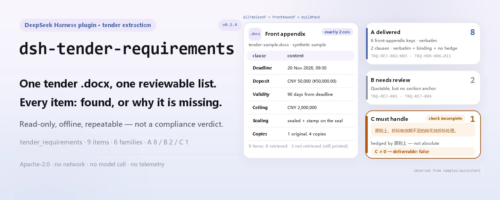

<div align="center">

<picture>
  <source media="(prefers-color-scheme: dark)" srcset="docs/assets/dsh-tender-requirements-hero-en-dark.webp">
  
</picture>

# dsh-tender-requirements

**एक निविदा दस्तावेज़ को समीक्षा-योग्य चेकलिस्ट में बदलें — हर मद बताती है क्या मिला और क्या अभी बाकी है।**

निविदा प्रबंधकों और एजेंटों के लिए स्थानीय एक्सट्रैक्टर: `.docx` का अग्र-परिशिष्ट और मुख्य भाग पढ़कर समय-सीमा, जमानत, वैधता, उच्चतम सीमा, निविदा संरचना और मूल/प्रतियों की संख्या बताता है, फिर सबको तीन कतारों — सौंपी गई / पुष्टि बाकी / अनिवार्य रूप से निपटाना है — में रखता है।

[इंस्टॉल](#तीन-चरणों-में-शुरुआत) · [कॉन्फ़िगरेशन](#कॉन्फ़िगरेशन) · [FAQ](#faq) · [简体中文](README.md) · [English](README.en.md) · [Español](README.es.md) · [Português](README.pt.md) · [हिन्दी](README.hi.md)

[](LICENSE)
[](#संगतता)
[](https://www.npmjs.com/package/dsh-tender-requirements)
[](https://github.com/PerryLink/dsh-tender-requirements/actions/workflows/ci.yml)
[](#संगतता)

[](https://github.com/PerryLink/dsh-tender-requirements/stargazers)
[](https://www.npmjs.com/package/dsh-tender-requirements)
[](https://dshfind.com/plugins/PerryLink/dsh-tender-requirements?ref=badge)
[](https://securityscorecards.dev/viewer/?uri=github.com/PerryLink/dsh-tender-requirements)

```sh
dsh plugin --profile <name> add dsh-tender-requirements
```

</div>

<sub>सामुदायिक प्लगइन, DeepSeek से असंबद्ध। कैनोनिकल रिपॉज़िटरी: <https://github.com/PerryLink/dsh-tender-requirements>।</sub>

## यह क्या है

`dsh-tender-requirements` एक केवल-पढ़ने वाला स्थानीय एक्सट्रैक्टर है, समीक्षक नहीं। यह आपके दिए `.docx` को खोलता है, दो-कॉलम अग्र-परिशिष्ट की पंक्तियों को जोड़ता है, फिर मुख्य भाग में निविदा-दस्तावेज़ की संरचना सूची और प्रतियों की संख्या खोजता है, और अंत में हर मद के लिए स्रोत, विश्वास और कारण के साथ रिपोर्ट देता है। न मिली मदें भी छपती हैं, और वे «नहीं मिला» कहती हैं, «दस्तावेज़ में नहीं है» नहीं। कोई मॉडल कॉल नहीं, कोई नेटवर्क अनुरोध नहीं, डेटा की दूसरी प्रति नहीं।

<picture>
  <source media="(prefers-color-scheme: dark)" srcset="docs/assets/dsh-tender-requirements-flow-v5-dark.svg">
  
</picture>

## तीन चरणों में शुरुआत

1. **इंस्टॉल करें** (npm चैनल; git और tarball भी चलते हैं):

   ```sh
   # npm चैनल (0.2.4 प्रकाशित)
   dsh plugin --profile web add dsh-tender-requirements
   # git चैनल (नवीनतम main)
   dsh plugin --profile web add github:PerryLink/dsh-tender-requirements
   # tarball चैनल: इस रेपो में pnpm pack के बाद
   dsh plugin --profile web add ./dsh-tender-requirements-0.2.4.tgz
   ```

   प्रोफ़ाइल `cordis.patch.yml` के ज़रिए `dsh-tender-requirements` पंक्ति जोड़ती है; टूल का नाम `tender_requirements` है।

2. **न्यूनतम कॉन्फ़िगरेशन** (डिफ़ॉल्ट चलते हैं; सिर्फ़ टाइमआउट बजट बदलना होता है):

   ```yaml
   - insert:
       - id: dsh-tender-requirements
         name: dsh-tender-requirements
         config:
           timeoutMs: 120000
   ```

3. **जाँचें कि माउंट हुआ**:

   ```sh
   dsh --profile web --dump-config | grep 'dsh-tender-requirements'
   pnpm run build && node samples/quickstart/run.mjs --check
   ```

   ```
   tender_requirements: quickstart OK — output matches expected/result.json
   ```

   सत्र में `tender_requirements` को `file` के साथ किसी `.docx` पर भी बुला सकते हैं।

**अनइंस्टॉल**: `dsh plugin --profile web remove dsh-tender-requirements` (या प्रोफ़ाइल patch से पंक्ति हटाएँ)।

## मुख्य क्षमताएँ

यह निष्कर्षण को निर्णय से अलग रखता है: हर परिणाम यह बताता है कि दस्तावेज़ में क्या लिखा है, अनुपालन का फ़ैसला नहीं।

अस्वीकृति-खंड किसी एक कीवर्ड तालिका पर निर्भर नहीं: विनिर्देश के नियंत्रित तुलना में केवल परिणाम-शब्दों वाली सूची (जैसे «अमान्य» या «अस्वीकृत») निर्मित डेटा पर 12/24 मिली, साथ में दो झूठे सकारात्मक; केवल ट्रिगर-शब्दों वाली सूची (जैसे «नहीं करना चाहिए», «करना होगा» या «अवश्य») 15/24 मिली, जिनमें आधे से अधिक क्रेता के अपने दायित्व थे। इसलिए पहचान छह शब्दावली परिवारों में बाँटी गई है।

- **नौ मदें, हर एक की रिपोर्ट** — निविदा की अंतिम तिथि, खोलने का समय, जमानत, निविदा की वैधता, उच्चतम सीमा, प्रतियों की संख्या, सीलिंग आवश्यकताएँ, साइट विज़िट और स्पष्टीकरण की अंतिम तिथि। हर मद में `value`, `source`, `confidence` और `reason` होते हैं; न मिलने पर भी कारण वाली पंक्ति बनती है।
- **पहले दो-कॉलम अग्र-परिशिष्ट** — सिर्फ़ ठीक दो कॉलम वाली तालिका को अग्र-परिशिष्ट माना जाता है; वहाँ कुंजी/मान मिलने पर विश्वास «उच्च» होता है। मुख्य भाग में कीवर्ड मिलने पर विश्वास «मध्यम» हो जाता है और चेतावनी रहती है कि शब्द अंतिम न हों।
- **संरचना सूची और प्रतियाँ** — प्रविष्टियाँ «निविदा दस्तावेज़ की संरचना» जैसी शुरुआती पंक्ति के बाद पढ़ी जाती हैं, क्रमागत संख्यांकित और कम से कम तीन होनी चाहिए; प्रतियों की गिनती चीनी और अरबी अंक दोनों लेती है, जिसमें अल्पविराम से अलग लिखा रूप भी है जिसे साधारण अंक regex नहीं पकड़ता।
- **तीन कतारों वाला RequirementsPack** — अस्वीकृति-खंड छह परिवारों (`refuse` / `invalid` / `reject` / `disqualify` / `deviation` / `postAward`) में बँटते हैं और A सौंपी गई, B पुष्टि बाकी, C अनिवार्य रूप से निपटाना है में रखे जाते हैं; जब तक C खाली नहीं, `deliverable: false` और रिपोर्ट कहती है कि जाँच अधूरी है।
- **दस विषयों का कवरेज नेट** — COV-01…COV-10 हर विषय के लिए «मिला» या «नहीं मिला» बताते हैं; न मिलना यह साबित नहीं करता कि दस्तावेज़ में वह विषय नहीं है।
- **स्थानीय और दोहराने योग्य** — कोई मॉडल कॉल नहीं, कोई नेटवर्क अनुरोध नहीं, कोई टेलीमेट्री नहीं; वही `.docx` हर बार वही परिणाम देता है।

### टूल और परिणाम सतह

| सतह | अर्थ |
|---|---|
| `tender_requirements` टूल | एकमात्र प्रवेश; `file` किसी `.docx` का निरपेक्ष पथ है |
| `mode: requirements` | डिफ़ॉल्ट; तीन-कतार पैक, markdown और मशीन-पठनीय JSON देता है |
| `mode: extract` | सिर्फ़ अग्र-परिशिष्ट और संरचना सूची देता है, कतारें नहीं |
| `markdown` | इंसान या मॉडल के पढ़ने योग्य रिपोर्ट |
| `resultJson` / `requirementsPack` | मशीन-पठनीय निष्कर्षण / RequirementsPack |

### उदाहरण

नीचे का आउटपुट इस रेपो की संश्लेषित नमूने से है; पहले `pnpm run build`, फिर `node samples/quickstart/run.mjs` चलाएँ।

```text
$ node samples/quickstart/run.mjs
tender_requirements: 6 found, 3 missing, 6 composition item(s) — deliverable false
queues: a=8 b=2 c=1
```

*Observed from `samples/quickstart/run.mjs`; `docs/assets/quickstart.log`; `samples/quickstart/expected/result.json`*

`--check` इन छह फ़ील्डों की `expected/result.json` से बाइट-दर-बाइट तुलना करता है; `--json` वही सारांश JSON के रूप में छापता है। टर्मिनल स्क्रीनशॉट [`docs/assets/quickstart.png`](docs/assets/quickstart.png) पर है।

**विफलता शाखा** — जब फ़ाइल `.docx` न हो या उसमें कोई पढ़ने योग्य तालिका न हो, निष्कर्षण fail-closed होकर `TenderError` देता है जो फ़ाइल का नाम लेता है और कहता है कि अग्र-परिशिष्ट आमतौर पर दो-कॉलम तालिका होती है (`src/model.ts:267`)। `file` तर्क न हो तो पढ़ने से पहले ही स्पष्ट संदेश के साथ विफल होता है (`src/index.ts:85`)।

### तीन कतारें कैसे बँटती हैं

| कतार | अर्थ | प्रवेश शर्त |
|---|---|---|
| A सौंपी गई | शब्दशः उद्धृत, बाध्यकारी अनुभाग में, बिना शर्त | छह परिवारों में कीवर्ड + निविदाकर्ता निर्देश या मूल्यांकन पद्धति जैसा अनुभाग, बिना शर्त शब्द |
| B पुष्टि बाकी | उद्धरण मौजूद, पर संरचनात्मक साक्ष्य कमज़ोर | छह परिवारों में कीवर्ड, पर बाध्यकारी अनुभाग के बाहर |
| C अनिवार्य रूप से निपटाना है | निकाला नहीं जा सकता, या कथन निरपेक्ष नहीं | «सिद्धांततः», «सामान्यतः», «हो सकता है», «स्थिति के अनुसार», «आवश्यक हो तो» जैसी शर्त, या शब्दशः मेल नहीं |

`deliverable` तभी `true` है जब C खाली हो; कतारें तीन साक्ष्य-शक्तियाँ हैं, तीन प्राथमिकताएँ नहीं।

## यह किन मानकों पर आधारित है

यह पैक अनुपालन तय करने के लिए अनुच्छेद नहीं उद्धृत करता — यह निष्कर्षण करता है, जाँच नहीं। यह उस संरचना को कूटबद्ध करता है जो अनुच्छेदों से निकलती है:

- वस्तु और सेवा सरकारी खरीद निविदा उपाय (आदेश 87) का अनुच्छेद 20 निविदा दस्तावेज़ में अनिवार्य 16 मदें गिनाता है, जिनमें मूल्यांकन पद्धति, मानदंड और अमान्य निविदा की स्थितियाँ हैं — इसीलिए अग्र-परिशिष्ट सूचना का केंद्र है।
- निविदा विधि का अनुच्छेद 23: स्पष्टीकरण, संशोधन या प्रश्नोत्तर कार्यवृत्त **निविदा दस्तावेज़ का भाग है**। यह पैक केवल मुख्य दस्तावेज़ पढ़ता है; यही छूटी आवश्यकताओं का ज्ञात व्यवस्थागत स्रोत है।

`rules/tender-requirements.yaml` नियम-पैक का लोकेटर है, और `rules: []` का अर्थ है कोई निष्पादन-योग्य नियम नहीं; चूँकि यहाँ कोई अनुच्छेद किसी निष्कर्ष का आधार नहीं है, `rules/evidence/` नहीं रखा जाता।

## सामग्री प्रारूप

इनपुट `.docx` होना चाहिए। तालिकाएँ `dsh-table-ingest` से एक-एक उम्मीदवार के रूप में पढ़ी जाती हैं — अग्र-परिशिष्ट ज़रूरी नहीं कि पहली तालिका हो, इसलिए सिर्फ़ डिफ़ॉल्ट तालिका लेना काफ़ी नहीं। अनुच्छेद उसी रीडर से आते हैं और संरचना सूची केवल अनुच्छेदों में खोजी जाती है।

अग्र-परिशिष्ट तब पहचाना जाता है जब तालिका में **ठीक दो कॉलम** हों। अगर हेडर डिटेक्टर ने किसी डेटा जोड़ी को हेडर चुन लिया (दूसरी कोशिका तारीख, रकम या गिनती जैसी लगे), तो वह जोड़ी पंक्ति के रूप में वापस ली जाती है — वरना स्पष्ट लिखी अंतिम तिथि चुपचाप छूट जाती।

टूल `.docx` के भीतर का पाठ और तालिकाएँ पढ़ता है; स्कैन या चित्र नहीं पढ़ता और OCR नहीं करता। कोई पढ़ने योग्य तालिका न हो तो `TenderError` फेंकता है।

## कॉन्फ़िगरेशन

केवल एक समायोज्य विकल्प है, टूल का टाइमआउट; नियम-फ़ाइल का कोई स्विच नहीं।

| कुंजी | डिफ़ॉल्ट | अर्थ |
|---|---|---|
| `timeoutMs` | `120000` | `tender_requirements` टूल का टाइमआउट बजट (मिलीसेकंड); समय खत्म होने पर होस्ट रद्द करता है |

<details>
<summary>पूरी कॉन्फ़िगरेशन तालिका (1 कुंजी)</summary>

| कुंजी | डिफ़ॉल्ट | अर्थ |
|---|---|---|
| `timeoutMs` | `120000` | `tender_requirements` टूल का टाइमआउट बजट (मिलीसेकंड); समय खत्म होने पर होस्ट रद्द करता है |

कोई अन्य समायोज्य नहीं; नियम-पैक का पथ पैकेज का स्थिर संसाधन है, कॉन्फ़िगरेशन कुंजी नहीं।

</details>

प्रोफ़ाइल patch में ओवरराइड:

```yaml
- insert:
    - id: dsh-tender-requirements
      name: dsh-tender-requirements
      config:
        timeoutMs: 300000
```

id से ओवरराइड पूरी पंक्ति बदल देता है — ज़रूरी सभी कुंजियाँ दोहराएँ।

## FAQ

<details>
<summary>क्या दस्तावेज़ अपलोड या सुरक्षित रखा जाता है?</summary>

नहीं। प्लगइन स्थानीय और केवल-पढ़ने वाला है: आपके दिए `.docx` के बाइट पढ़ता है, कोई नेटवर्क अनुरोध नहीं करता, मॉडल नहीं बुलाता और दूसरी प्रति नहीं लिखता। टूल का परिणाम DSH होस्ट के अपने सत्र लॉग में जाता है (यह होस्ट का व्यवहार है); अगर दस्तावेज़ में संवेदनशील जानकारी है तो उस लॉग को सामान्य नियमों से संभालें।

</details>

<details>
<summary>«नहीं मिला» का अर्थ है निविदा दस्तावेज़ में वह मद नहीं है?</summary>

नहीं। «नहीं मिला» सिर्फ़ यह बताता है कि इस बार अग्र-परिशिष्ट की कुंजी या मुख्य भाग के अनुच्छेद में वह मद नहीं मिली। अलग शब्दावली, तालिका की कोशिका या किसी संशोधन में लिखी बात छूट सकती है। रिपोर्ट मानवीय समीक्षा माँगती है।

</details>

<details>
<summary>«C खाली होने पर ही पूरा» का क्या अर्थ है?</summary>

C में वे खंड हैं जो टूल निकाल नहीं सका या जो निरपेक्ष कथन नहीं हैं। जब तक C खाली नहीं, `deliverable` `false` है और रिपोर्ट का शीर्ष कहता है कि जाँच अधूरी है। C को हाथ से पूरा करके फिर चलाएँ, तब पैक को पूरा मानें। एक मिलीजुली सूची टूल को तब «कोई समस्या नहीं» कहने देती जब उसे सिर्फ़ उद्धरण-योग्य हिस्सा मिला हो — तीन कतारें ठीक इसी से बचाती हैं।

</details>

<details>
<summary>क्या यह दूसरे प्लगइनों से टकराएगा?</summary>

यह नेमस्पेस वाला एक ही टूल `tender_requirements` पंजीकृत करता है और केवल `tools` इंजेक्ट करता है। कोई सेवा-कुंजी नहीं, कोई सत्र-इवेंट श्रोता नहीं, कोई क्लाइंट स्लॉट नहीं, कोई HTTP रूट नहीं और कोई वैश्विक ऑब्जेक्ट नहीं बदलता। `dsh-table-ingest` लाइब्रेरी के रूप में इस्तेमाल होता है, अलग प्लगइन पंक्ति के रूप में नहीं।

</details>

<details>
<summary>बड़ा दस्तावेज़ धीमा होगा?</summary>

कोई मॉडल कॉल नहीं; समय `.docx` खोलने और तालिकाएँ एक-एक पढ़ने में जाता है, और `dsh-table-ingest` में प्रविष्टि-संख्या व आउटपुट बजट हैं। डिफ़ॉल्ट टाइमआउट 120 सेकंड है और `timeoutMs` से बदला जा सकता है।

</details>

## समस्या निवारण

- **इंस्टॉल होता है पर टूल नहीं दिखता**: जाँचें कि `main` `lib/index.mjs` पर जाता है और `pnpm run build` ने `lib/` बनाया है (बिल्ड आउटपुट रेपो में नहीं रखा जाता)।
- **`dsh plugin add` पैकेज अस्वीकार करता है**: होस्ट लाइन `>=0.2.1-0 <0.3.0` में होनी चाहिए; बाहर हो तो पुराना कोर ज़बरदस्ती न डालें, स्पष्ट छूट लें।
- **कोई मद कभी नहीं निकलती**: देखें कि `coverage.topics` की संबंधित प्रविष्टि `hit: false` है या नहीं, और `notes` पढ़ें; अग्र-परिशिष्ट हो तो पुष्टि करें कि वह ठीक दो कॉलम की तालिका है।
- **«कोई पढ़ने योग्य तालिका नहीं» आता है**: फ़ाइल `.docx` नहीं हो सकती या अग्र-परिशिष्ट तालिका नहीं हो सकता; यह टूल स्कैन पर OCR नहीं करता।
- **पुराना `skipped` array**: वह नियम-जाँचकर्ता परिवार का आउटपुट है; यह पैक एक्सट्रैक्टर है और `skipped` नहीं बनाता — समतुल्य जानकारी `coverage.topics` और `notes` में है।

## सुरक्षा सीमाएँ

- **केवल-पढ़ना, ऑफ़लाइन।** केवल दिया गया `.docx` पढ़ता है, कोई नेटवर्क अनुरोध नहीं, कोई मॉडल कॉल नहीं और पैकेज के बाहर कोई डेटा नहीं लिखता; कोई टेलीमेट्री, एनालिटिक्स या पृष्ठभूमि रिपोर्टिंग नहीं।
- **निष्कर्षण निर्णय नहीं है।** आउटपुट कहता है «दस्तावेज़ में ऐसा लिखा है», यह नहीं कि «कानूनी रूप से मान्य है» या «निविदा जीतेगी»; अनुपालन या दायित्व का फ़ैसला नहीं करता।
- **नहीं मिला ≠ मौजूद नहीं।** हर चूक के साथ कारण है; रिपोर्ट कमी को नकारात्मक निष्कर्ष में नहीं बदलती।
- **fail-closed।** पढ़ने योग्य तालिका न हो तो खाली सफलता के बजाय त्रुटि फेंकता है; अनुच्छेद न पढ़ पाने पर चेतावनी देता है कि केवल तालिका निष्कर्षण हुआ।
- **सत्र-लॉग सीमा।** टूल के लौटाए मान (उद्धरण और फ़ाइल पथ सहित) DSH होस्ट के अपने सत्र/लॉग भंडार में जाते हैं; यह पैक अतिरिक्त प्रति नहीं जोड़ता, पर होस्ट की retention नियंत्रित नहीं करता।

## अनुमतियाँ और डेटा

- **अनुमतियाँ**: `dsh.capabilities` केवल `tools:register` घोषित करता है; प्लगइन आपके बताए `.docx` को पढ़ता है और परिणाम होस्ट को देता है।
- **डेटा**: दूसरी फ़ाइल नहीं लिखता, डेटाबेस नहीं बनाता, नेटवर्क अनुरोध नहीं करता; अनइंस्टॉल केवल कोड हटाता है, होस्ट के सत्र लॉग या आपके बनाए दस्तावेज़ नहीं मिटाता।
- **गोपनीयता**: `PRIVACY.md` का कथन npm पैकेज पर लागू है, DSH होस्ट या प्रोफ़ाइल के अन्य प्लगइनों पर नहीं।

## ज्ञात सीमाएँ

- **केवल मुख्य दस्तावेज़।** स्पष्टीकरण, संशोधन, परिशिष्ट और प्रश्नोत्तर कार्यवृत्त कानूनन निविदा दस्तावेज़ का भाग हैं (निविदा विधि, अनुच्छेद 23), और यह टूल उन्हें नहीं जोड़ता; निर्णय से पहले हाथ से जोड़ें। यही छूटी आवश्यकताओं का सबसे बड़ा व्यवस्थागत स्रोत है।
- **अग्र-परिशिष्ट दो-कॉलम तालिका होना चाहिए।** तीन-कॉलम, मर्ज की गई कोशिकाओं वाला या चित्र रूप में अग्र-परिशिष्ट नहीं पहचाना जाता; तब कुंजी मान मुख्य भाग के हिट (मध्यम विश्वास) या «नहीं मिला» में चले जाते हैं।
- **संरचना सूची की संरचनात्मक शर्तें हैं।** «निविदा दस्तावेज़ की संरचना» जैसी शुरुआती पंक्ति के बाद कम से कम तीन क्रमागत संख्यांकित प्रविष्टियाँ चाहिए; संख्या में उछाल सूची समाप्त कर देता है।
- **प्रतियाँ केवल मूल/प्रति के चीनी लेबल, उसके बाद संख्या और माप शब्द पर मेल खाती हैं।** चीनी और अरबी अंक दोनों चलते हैं, पर «एक मूल, चार प्रतियाँ» जैसा संक्षिप्त रूप दूसरी तरह से नहीं पढ़ा जाता; दोनों में से कोई गिनती न बने तो रिपोर्ट हाथ से जाँचने को कहती है।
- **अस्वीकृति-खंड केवल मुख्य भाग के अनुच्छेदों में खोजे जाते हैं।** छह परिवारों (`refuse` / `invalid` / `reject` / `disqualify` / `deviation` / `postAward`) से बाहर की शब्दावली वर्गीकृत नहीं होती; तालिका में लिखा अस्वीकृति-खंड भी कतारों में नहीं आता।
- **कवरेज नेट कीवर्ड-आधारित है।** COV-01…COV-10 केवल बताते हैं कि संबंधित शब्दावली मिली या नहीं; यह कानूनी पूर्णता की जाँच नहीं, हर चूक पर मानवीय पुष्टि चाहिए।
- **मुख्य भाग का हिट पहला अनुच्छेद लेता है।** कीवर्ड कई अनुच्छेदों में हो तो पहला मेल 200 अक्षरों तक काटा जाता है और अंतिम शब्दावली न हो सकता है।
- **स्कैन नहीं।** इनपुट ऐसा `.docx` हो जिसमें पाठ या तालिकाएँ हों; PDF, चित्र और OCR दायरे से बाहर हैं।
- **कोई evidence निर्देशिका नहीं।** यहाँ कोई अनुच्छेद किसी निष्कर्ष का आधार नहीं, इसलिए `rules/evidence/` नहीं रखा जाता; `rules/tender-requirements.yaml` में `rules: []` जानबूझकर है।

## अन्य DSH प्लगइनों के साथ इंटरऑपरेबिलिटी

इस रेपो के प्लगइन अनुबंध और निर्भरता सतह के विरुद्ध जाँचा गया; निष्कर्ष यह है कि यह दूसरे प्लगइनों की किसी साझा सतह पर कब्ज़ा नहीं करता:

- **टूल नाम का टकराव नहीं।** केवल `tender_requirements` पंजीकृत करता है, जो इस पैकेज के नेमस्पेस का नाम है, और किसी अंतर्निहित टूल का खुला नाम नहीं लेता।
- **सेवा-कुंजी का टकराव नहीं।** कोई सेवा नहीं देता, केवल `tools` उपभोग करता है।
- **इवेंट श्रोता नहीं।** `agent/*` या `tools/*` जैसे सत्र-इवेंट की सदस्यता नहीं लेता, इसलिए श्रोता क्रम या शॉर्ट-सर्किट का प्रश्न नहीं।
- **स्लॉट या HTTP रूट नहीं।** कोई ब्राउज़र भाग नहीं, क्लाइंट स्लॉट नहीं, `webServer` उपसर्ग नहीं।
- **वैश्विक बदलाव नहीं।** प्रोटोटाइप, `process.env` या वैश्विक ऑब्जेक्ट नहीं छेड़ता; `dsh-table-ingest` लाइब्रेरी के रूप में आयात होता है।
- **patch सीमा।** `cordis.patch.yml` केवल अपनी पंक्ति `insert` करता है और किसी दूसरी पंक्ति का `config` नहीं लिखता।

स्थिर साक्ष्य: `pnpm run verify:self-contained` और `pnpm run check:lockfile` CI में चलते हैं; निर्भरता विवरण registry से आते हैं।

## संगतता

| आयाम | स्थिति |
|---|---|
| Harness | `>=0.2.1-0 <0.3.0` (package.json `engines.dsh`); `@deepseek-ai/dsh-tools` peer `>=0.1.2-rc.1 <0.2.0 \|\| >=0.2.0-0 <0.3.0` कवर करता है |
| Node | `^22.19.0 \|\| >=24.0.0` |
| प्लेटफ़ॉर्म | जहाँ DSH चले (शुद्ध ESM; कोई नेटिव कोड नहीं, कोई नेटवर्क नहीं, कोई मॉडल कॉल नहीं) |
| मॉडल | किसी मॉडल क्षमता की ज़रूरत नहीं; निष्कर्षण पूरी तरह स्थानीय |
| इनपुट | `.docx` (पाठ और तालिकाएँ; OCR नहीं) |

## इकोसिस्टम और गुणवत्ता

- [npm पैकेज](https://www.npmjs.com/package/dsh-tender-requirements) (0.2.4)
- [dshfind प्लगइन पृष्ठ](https://dshfind.com/plugins/PerryLink/dsh-tender-requirements) (इंस्टॉल और रैंकिंग)
- [OpenSSF Scorecard रिपोर्ट](https://securityscorecards.dev/viewer/?uri=github.com/PerryLink/dsh-tender-requirements) ([.github/workflows/scorecard.yml](.github/workflows/scorecard.yml) से संचालित)
- **गुणवत्ता गेट**: `typecheck` · `vitest` (निष्कर्षण, कतारें, सीमा-अर्थ और संस्करण तालमेल) · `verify:self-contained` · `check:lockfile` · `check:readmes` · `check:citations`, सभी CI में
- **संश्लेषित नमूना**: `samples/quickstart/` में इनपुट `.docx`, अपेक्षित परिणाम और दोहराने योग्य स्क्रिप्ट है

## डेवलपमेंट

```sh
pnpm install
pnpm run typecheck
pnpm test
pnpm run build
pnpm run verify:self-contained
pnpm run check:lockfile
pnpm run check:readmes
pnpm run check:citations
pnpm pack
node samples/quickstart/run.mjs --check   # build के बाद
```

निर्देशिका संरचना:

| पथ | सामग्री |
|---|---|
| `src/index.ts` | प्लगइन प्रवेश: `tender_requirements` टूल पंजीकृत करता है, `.docx` पढ़ता है, परिणाम जोड़ता है |
| `src/model.ts` | निष्कर्षण कोर: अग्र-परिशिष्ट, नौ मदें, संरचना सूची, प्रतियाँ, कवरेज |
| `src/requirements.ts` | RequirementsPack: छह अस्वीकृति परिवार, A/B/C कतारें, दस-विषय कवरेज नेट |
| `src/report.ts` / `src/pack-report.ts` | मनुष्य-पठनीय markdown |
| `src/config.ts` | Schemastery कॉन्फ़िगरेशन (`timeoutMs`) |
| `src/shared/` | परिवार का साझा किट (कॉपी किया हुआ, अतिरिक्त निर्भरता नहीं) |
| `rules/tender-requirements.yaml` | नियम-पैक लोकेटर (`rules: []`) |
| `samples/quickstart/` | दोहराने योग्य संश्लेषित नमूना |
| `tests/` | vitest सूट और `.docx` fixture |
| `scripts/` | यांत्रिक गेट और चित्र जनरेटर |

चित्र [`scripts/gen-readme-assets.py`](scripts/gen-readme-assets.py) से क्रमानुसार बनते हैं: Python + Pillow से हल्के/गहरे hero WebP और हस्तलिखित हल्के/गहरे संरचना SVG, फ़ाइल नाम `dsh-tender-requirements-` से शुरू होते हैं; दोबारा चलाने के लिए `python scripts/gen-readme-assets.py`।

साझा कोड तालमेल: `src/shared/` परिवार के साझा किट से कॉपी होता है; परिवार कार्यक्षेत्र में `node ../scripts/sync-shared.mjs dsh-tender-requirements` से ताज़ा किया जा सकता है (स्वतंत्र क्लोन में वह स्क्रिप्ट नहीं है)।

विषय: `dsh`, `dsh-plugin`, `deepseek-harness`, `deepseek`, `cordis`, `tender`, `extraction`, `bid`, `requirements`

## परिवार और आभार

यह परियोजना [PerryLink](https://github.com/PerryLink) द्वारा अनुरक्षित DeepSeek Harness प्लगइन परिवार की सदस्य है (सभी Apache-2.0)। पूरा परिवार सूचकांक: [सामग्री के अनुसार जाँचकर्ता चुनें](https://perrylink.github.io/zh/checkers/choose/); सभी प्लगइन नीचे तालिका में हैं। अगर इसने मदद की, **स्टार दें** — इससे कोई सुविधा नहीं खुलती, पर अगला व्यक्ति इसे आसानी से ढूँढ पाएगा।

- [@PerryLink](https://github.com/PerryLink) — निर्माता और अनुरक्षक: एक्सट्रैक्टर, तीन-कतार RequirementsPack, दस-विषय कवरेज नेट और पाँच-भाषा दस्तावेज़।

<details>
<summary>सभी प्लगइन खोलें</summary>

| प्लगइन | स्थिति |
|---|---|
| **[dsh-aqua-input-check](https://github.com/PerryLink/dsh-aqua-input-check)** |  |
| **[dsh-archive-check](https://github.com/PerryLink/dsh-archive-check)** |  |
| **[dsh-auto-review](https://github.com/PerryLink/dsh-auto-review)** |  |
| **[dsh-autotier](https://github.com/PerryLink/dsh-autotier)** | 🧊 फ़्रोज़न — रेपो README देखें |
| **[dsh-bid-ca-precheck](https://github.com/PerryLink/dsh-bid-ca-precheck)** |  |
| **[dsh-bid-qual-check](https://github.com/PerryLink/dsh-bid-qual-check)** |  |
| **[dsh-cert-mcp](https://github.com/PerryLink/dsh-cert-mcp)** | 🧊 फ़्रोज़न — रेपो README देखें |
| **[dsh-checkpoint-rewind](https://github.com/PerryLink/dsh-checkpoint-rewind)** |  |
| **[dsh-click](https://github.com/PerryLink/dsh-click)** |  |
| **[dsh-composer-history](https://github.com/PerryLink/dsh-composer-history)** |  |
| **[dsh-contract-stance](https://github.com/PerryLink/dsh-contract-stance)** |  |
| **[dsh-customs-doc-check](https://github.com/PerryLink/dsh-customs-doc-check)** |  |
| **[dsh-data-quality](https://github.com/PerryLink/dsh-data-quality)** | 🧊 फ़्रोज़न — रेपो README देखें |
| **[dsh-demurrage-ledger](https://github.com/PerryLink/dsh-demurrage-ledger)** |  |
| **[dsh-doublecheck](https://github.com/PerryLink/dsh-doublecheck)** |  |
| **[dsh-drill-script-check](https://github.com/PerryLink/dsh-drill-script-check)** |  |
| **[dsh-eia-guide-check](https://github.com/PerryLink/dsh-eia-guide-check)** |  |
| **[dsh-emergency-plan](https://github.com/PerryLink/dsh-emergency-plan)** |  |
| **[dsh-essay-rubric-check](https://github.com/PerryLink/dsh-essay-rubric-check)** |  |
| **[dsh-evidence-check](https://github.com/PerryLink/dsh-evidence-check)** |  |
| **[dsh-export-ctl-check](https://github.com/PerryLink/dsh-export-ctl-check)** |  |
| **[dsh-fast](https://github.com/PerryLink/dsh-fast)** |  |
| **[dsh-fmea-table-check](https://github.com/PerryLink/dsh-fmea-table-check)** |  |
| **[dsh-forecast-penalty](https://github.com/PerryLink/dsh-forecast-penalty)** |  |
| **[dsh-fund-research](https://github.com/PerryLink/dsh-fund-research)** |  |
| **[dsh-github](https://github.com/PerryLink/dsh-github)** |  |
| **[dsh-gongwen-flow-check](https://github.com/PerryLink/dsh-gongwen-flow-check)** |  |
| **[dsh-gongwen-word-check](https://github.com/PerryLink/dsh-gongwen-word-check)** |  |
| **[dsh-guard-plan-qc](https://github.com/PerryLink/dsh-guard-plan-qc)** |  |
| **[dsh-hazchem-check](https://github.com/PerryLink/dsh-hazchem-check)** |  |
| **[dsh-hazplan-check](https://github.com/PerryLink/dsh-hazplan-check)** |  |
| **[dsh-hidden-risk-map](https://github.com/PerryLink/dsh-hidden-risk-map)** |  |
| **[dsh-hs-classify](https://github.com/PerryLink/dsh-hs-classify)** |  |
| **[dsh-icd-rule-check](https://github.com/PerryLink/dsh-icd-rule-check)** |  |
| **[dsh-industry-research](https://github.com/PerryLink/dsh-industry-research)** |  |
| **[dsh-lawcite-adapter](https://github.com/PerryLink/dsh-lawcite-adapter)** |  |
| **[dsh-laya](https://github.com/PerryLink/dsh-laya)** |  |
| **[dsh-lc-doc-check](https://github.com/PerryLink/dsh-lc-doc-check)** |  |
| **[dsh-learning-gap-check](https://github.com/PerryLink/dsh-learning-gap-check)** |  |
| **[dsh-library](https://github.com/PerryLink/dsh-library)** |  |
| **[dsh-local-ai](https://github.com/PerryLink/dsh-local-ai)** |  |
| **[dsh-lsp-actions](https://github.com/PerryLink/dsh-lsp-actions)** |  |
| **[dsh-mask](https://github.com/PerryLink/dsh-mask)** |  |
| **[dsh-mcp-panel](https://github.com/PerryLink/dsh-mcp-panel)** |  |
| **[dsh-medrec-qc](https://github.com/PerryLink/dsh-medrec-qc)** |  |
| **[dsh-memento](https://github.com/PerryLink/dsh-memento)** | 🧊 फ़्रोज़न — रेपो README देखें |
| **[dsh-nsfc-form-check](https://github.com/PerryLink/dsh-nsfc-form-check)** |  |
| **[dsh-nurse-record-check](https://github.com/PerryLink/dsh-nurse-record-check)** |  |
| **[dsh-observe](https://github.com/PerryLink/dsh-observe)** |  |
| **[dsh-origin-rvc-check](https://github.com/PerryLink/dsh-origin-rvc-check)** |  |
| **[dsh-ota-review-check](https://github.com/PerryLink/dsh-ota-review-check)** |  |
| **[dsh-output-styles](https://github.com/PerryLink/dsh-output-styles)** |  |
| **[dsh-paper-doc-adapter](https://github.com/PerryLink/dsh-paper-doc-adapter)** |  |
| **[dsh-permission-rules](https://github.com/PerryLink/dsh-permission-rules)** |  |
| **[dsh-permit-report-check](https://github.com/PerryLink/dsh-permit-report-check)** |  |
| **[dsh-pipeline-check](https://github.com/PerryLink/dsh-pipeline-check)** |  |
| **[dsh-pleading-draft](https://github.com/PerryLink/dsh-pleading-draft)** |  |
| **[dsh-plugin-doctor](https://github.com/PerryLink/dsh-plugin-doctor)** | 🚫 रिटायर्ड (रेपो संग्रहीत) |
| **[dsh-plugin-guide](https://github.com/PerryLink/dsh-plugin-guide)** |  |
| **[dsh-plugin-kit](https://github.com/PerryLink/dsh-plugin-kit)** | 🚫 रिटायर्ड (रेपो संग्रहीत) |
| **[dsh-plugin-upgrade](https://github.com/PerryLink/dsh-plugin-upgrade)** | 🚫 रिटायर्ड (रेपो संग्रहीत) |
| **[dsh-policy-brief-draft](https://github.com/PerryLink/dsh-policy-brief-draft)** |  |
| **[dsh-power-loss-split](https://github.com/PerryLink/dsh-power-loss-split)** |  |
| **[dsh-power-ticket-check](https://github.com/PerryLink/dsh-power-ticket-check)** |  |
| **[dsh-ppap-check](https://github.com/PerryLink/dsh-ppap-check)** |  |
| **[dsh-protest-deadline](https://github.com/PerryLink/dsh-protest-deadline)** |  |
| **[dsh-railway-window](https://github.com/PerryLink/dsh-railway-window)** |  |
| **[dsh-repair-order-qc](https://github.com/PerryLink/dsh-repair-order-qc)** |  |
| **[dsh-research-report](https://github.com/PerryLink/dsh-research-report)** |  |
| **[dsh-review-reply-check](https://github.com/PerryLink/dsh-review-reply-check)** |  |
| **[dsh-rulefile-check](https://github.com/PerryLink/dsh-rulefile-check)** |  |
| **[dsh-safety-brief-check](https://github.com/PerryLink/dsh-safety-brief-check)** |  |
| **[dsh-score](https://github.com/PerryLink/dsh-score)** | 🧊 फ़्रोज़न — रेपो README देखें |
| **[dsh-session-sync](https://github.com/PerryLink/dsh-session-sync)** |  |
| **[dsh-site-log-check](https://github.com/PerryLink/dsh-site-log-check)** |  |
| **[dsh-skill-pack-security](https://github.com/PerryLink/dsh-skill-pack-security)** |  |
| **[dsh-soe-decision-check](https://github.com/PerryLink/dsh-soe-decision-check)** |  |
| **[dsh-soilwater-check](https://github.com/PerryLink/dsh-soilwater-check)** |  |
| **[dsh-sop-sync-check](https://github.com/PerryLink/dsh-sop-sync-check)** |  |
| **[dsh-spc-gbt-adapter](https://github.com/PerryLink/dsh-spc-gbt-adapter)** |  |
| **[dsh-talk](https://github.com/PerryLink/dsh-talk)** |  |
| **[dsh-tender-extract](https://github.com/PerryLink/dsh-tender-extract)** |  |
| **[dsh-tender-matrix](https://github.com/PerryLink/dsh-tender-matrix)** |  |
| **[dsh-test-drive](https://github.com/PerryLink/dsh-test-drive)** |  |
| **[dsh-ticktick](https://github.com/PerryLink/dsh-ticktick)** | 🚫 रिटायर्ड (रेपो संग्रहीत) |
| **[dsh-translate](https://github.com/PerryLink/dsh-translate)** |  |
| **[dsh-warranty-calc](https://github.com/PerryLink/dsh-warranty-calc)** |  |
| **[dsh-budget](https://github.com/PerryLink/dsh-budget)** | 🧊 फ़्रोज़न — रेपो README देखें |
| **[dsh-claude-move](https://github.com/PerryLink/dsh-claude-move)** | 🧊 फ़्रोज़न — रेपो README देखें |
| **[dsh-defend](https://github.com/PerryLink/dsh-defend)** | 🧊 फ़्रोज़न — रेपो README देखें |
| **[dsh-draw](https://github.com/PerryLink/dsh-draw)** | 🧊 फ़्रोज़न — रेपो README देखें |
| **[dsh-reach](https://github.com/PerryLink/dsh-reach)** | 🧊 फ़्रोज़न — रेपो README देखें |
| **[dsh-background-agents](https://github.com/PerryLink/dsh-background-agents)** | 🚫 रिटायर्ड (रेपो संग्रहीत) |
| **[dsh-session-pin](https://github.com/PerryLink/dsh-session-pin)** | 🚫 रिटायर्ड (रेपो संग्रहीत) |
| **[dsh-team-rooms](https://github.com/PerryLink/dsh-team-rooms)** | 🚫 रिटायर्ड (रेपो संग्रहीत) |

</details>

## लाइसेंस

[LICENSE](LICENSE) (Apache License 2.0) © 2026 dsh-tender-requirements contributors

<p align="center"><sub>Apache-2.0 · सामुदायिक प्लगइन, DeepSeek से असंबद्ध।</sub></p>
