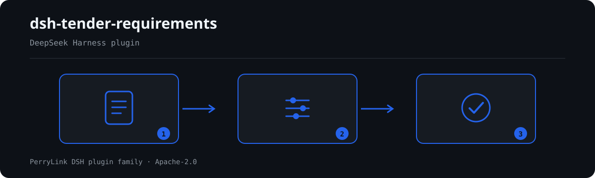

# dsh-tender-requirements — Tender requirements

[English](README.md) · [简体中文](README-zh.md) · [Español](README-es.md) · [Português](README-pt.md) · [हिन्दी](README-hi.md)

<!-- topblock:v1 -->
> **What it is** — Extracts dates, bid security, document composition and copy counts from a tender document, and says whether each was found.
> **Who it is for** — bidders and tender agents.
> **What you give it** — a tender document to extract key terms from
> **What it does not do** — no compliance verdict, no liability finding, no replacement for the reviewer; differences only.
> **How to start** — from the command line (not sold separately yet):
> `dsh plugin --profile <name> add dsh-tender-requirements`
<!-- /topblock:v1 -->

[](https://dshfind.com/en/plugins/PerryLink/dsh-tender-requirements?ref=badge)

`dsh-tender-requirements` reads a tender document and reports what it could find: the front-appendix deadlines, deposit, validity and ceiling; the required composition of a bid; and the original/duplicate copy counts.

Every item it looked for is printed whether or not it was found. "Not retrieved" is a different sentence from "the document does not say", and only the first is something a keyword extractor can support.

## Install

```sh
dsh plugin --profile <name> add dsh-tender-requirements
dsh --profile <name> --dump-config | grep 'dsh-tender-requirements'
```

## What it looks like



*Workflow overview: document → rule pack → findings.*

**Boundary:** this is a finder, not a reviewer. It does not judge whether the tender document is compliant, and cannot tell whether a bid will win. It reads the **main document only** — clarifications, amendments and Q&A minutes are part of the tender document by law (招标投标法第23条) and are not merged here, which is a known systematic gap: please combine them by hand. And nothing here decides that a clause is absent; a differently-worded clause is simply not matched.

## What it answers

- What deadline, deposit, validity period and ceiling does the front appendix state?
- What must a bid contain, in what order?
- How many originals and duplicates are required?
- Which rejection clauses can be quoted verbatim, which need a human look, and which
  could not be extracted at all?
- Which of the ten coverage topics were not found, so they can be confirmed by hand?

## Standards it follows

No clause is quoted as authority for a check, because this package extracts rather than checks. What it does encode is the structure the clauses imply:

- 政府采购货物和服务招标投标管理办法（87号令）第20条 lists the 16 items a tender document must contain, including 「评标方法、评标标准和投标无效情形」 — that is why the front appendix is the information hub.
- 招标投标法第23条: a clarification or amendment **is part of the tender document**. It is listed as a known gap because it is the single largest source of missed requirements.

## Compatibility

| Surface | Status |
|---|---|
| Harness | peer range `>=0.1.2-rc.1 <0.2.0 \|\| >=0.2.0-0 <0.3.0` |
| Node | `^22.19.0 || >=24.0.0` |
| Platforms | all (pure ESM; no native code, no network, no model call) |

## What it does

**Three queues, not one list.** Every clause lands in A 交付 (quoted verbatim, in a
binding section, no hedge), B 待确认 (quoted but structurally weak), or C 必须处理
(could not be quoted, or is hedged). While C is non-empty the pack reports
`deliverable: false` and the report says the check is 未完成体检 — a merged list is
what lets a tool say "no findings" when it only found nothing it could quote.

Rejection clauses are sorted into families (`refuse` / `invalid` / `reject` /
`disqualify` / `deviation` / `postAward`) rather than one keyword table.

Recognition is per item, not one keyword table. The spec's probe showed why: on constructed data a result-only word list hit 12/24 with two false positives, and a trigger-only list (不得/应当/必须) hit 15/24 of which over half were the buyer's own obligations.

So each item carries its own pattern and reports a confidence with a reason:

| Confidence | When |
|---|---|
| 高 | found in a two-column front-appendix key |
| 中 | found in body text, where the wording may not be final |
| 低 | not found; the reason says whether the label appeared at all |

Copy counts accept Chinese numerals and the comma-separated form (`正本一份，副本四份`), which the obvious regex misses.

## Configuration

| Key | Default | Meaning |
|---|---|---|
| `rulesFile` | `rules/tender-requirements.yaml` | 规则库路径 |

## Material format

Input is a `.docx`. Tables are read through `dsh-table-ingest`, one candidate at a time, because the front appendix is not necessarily the first table. Paragraphs come from the same reader and supply the composition list.

A front appendix is recognised as a table with exactly two columns. If the header detector has chosen a data pair as the header (its second cell looks like a date, an amount or a count), that pair is recovered as a row — otherwise a stated deadline would be silently missing.

## Rule sources

There is no evidence directory, because nothing here cites a clause as the basis of a finding.

Known limits: only the main document is read; the front appendix must be a two-column table; the composition list must be a run of at least three numbered entries introduced by a lead-in sentence; and a document that states a value in an unusual wording will be reported as not retrieved rather than guessed.

## Troubleshooting

- **The plugin installs but the tool never appears**: check that `main` resolves to `lib/index.mjs` and that `pnpm run build` produced it.
- **`dsh plugin add` rejects the package**: the peer range covers `0.1.x` and `0.2.x`; outside it, grant an explicit exemption.
- **A rule did not run**: read the `skipped` array.

## Development

```sh
pnpm install
pnpm run typecheck
pnpm test
pnpm run build
node ../scripts/sync-shared.mjs dsh-tender-requirements
```

## PerryLink DSH Plugin Family

Full family index: [choose a checker by material](https://perrylink.github.io/zh/checkers/choose/) and [all plugins](https://github.com/PerryLink). This repository is one of them.

## License

[Apache License 2.0](LICENSE) © 2026 dsh-tender-requirements contributors.
