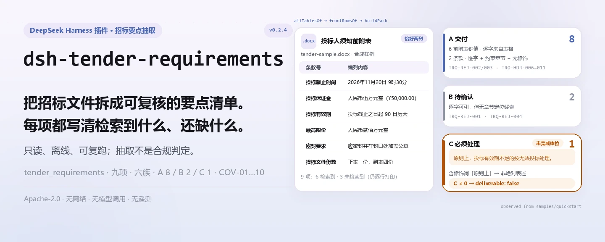
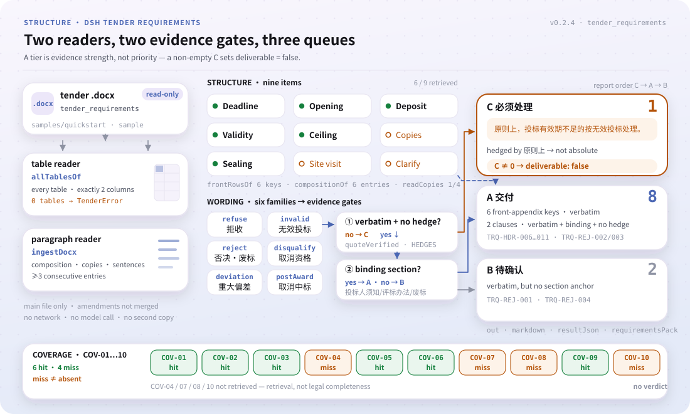

<div align="center">

<picture>
  <source media="(prefers-color-scheme: dark)" srcset="docs/assets/dsh-tender-requirements-hero-zh-dark.webp">
  
</picture>

# dsh-tender-requirements

**把一份招标文件拆成可复核的要点清单——每一项都告诉你检索到什么、还缺什么。**

面向投标专员与招标代理的本地抽取插件：读 `.docx` 的前附表与正文，给出时间、保证金、有效期、最高限价、投标文件组成和正副本份数，再按「可交付 / 待确认 / 必须处理」三队列装进 RequirementsPack。

[安装](#三步上手) · [配置](#配置) · [FAQ](#faq) · [简体中文](README.md) · [English](README.en.md) · [Español](README.es.md) · [Português](README.pt.md) · [हिन्दी](README.hi.md)

[](LICENSE)
[](#兼容性)
[](https://www.npmjs.com/package/dsh-tender-requirements)
[](https://github.com/PerryLink/dsh-tender-requirements/actions/workflows/ci.yml)
[](#兼容性)

[](https://github.com/PerryLink/dsh-tender-requirements/stargazers)
[](https://www.npmjs.com/package/dsh-tender-requirements)
[](https://dshfind.com/plugins/PerryLink/dsh-tender-requirements?ref=badge)
[](https://securityscorecards.dev/viewer/?uri=github.com/PerryLink/dsh-tender-requirements)

```sh
dsh plugin --profile <name> add dsh-tender-requirements
```

</div>

<sub>社区插件，与 DeepSeek 官方无关。唯一仓库：<https://github.com/PerryLink/dsh-tender-requirements>。</sub>

## 它是什么

`dsh-tender-requirements` 是一个只读的本地抽取器，不是审阅器。它打开你给的 `.docx`，把前附表中的两列表格逐行配对，再从正文里找投标文件组成清单与份数，最后输出一份带出处、置信度和理由的报告。找不到的项也会打印，并明确写「未检索到」而不是「文件里没有」。整个过程不调用模型、不联网、不写第二份数据。

<picture>
  <source media="(prefers-color-scheme: dark)" srcset="docs/assets/dsh-tender-requirements-flow-v5-dark.svg">
  
</picture>

## 三步上手

1. **安装**（npm 通道；也可从 git 或 tarball 装）：

   ```sh
   # npm 通道（已发布 0.2.4）
   dsh plugin --profile web add dsh-tender-requirements
   # git 通道（最新 main）
   dsh plugin --profile web add github:PerryLink/dsh-tender-requirements
   # tarball 通道：本仓库 pnpm pack 后
   dsh plugin --profile web add ./dsh-tender-requirements-0.2.4.tgz
   ```

   安装后 profile 会通过 `cordis.patch.yml` 插入一行 `dsh-tender-requirements`，工具名是 `tender_requirements`。

2. **最小配置**（默认即可用；只有超时预算需要调）：

   ```yaml
   - insert:
       - id: dsh-tender-requirements
         name: dsh-tender-requirements
         config:
           timeoutMs: 120000
   ```

3. **验证已生效**：

   ```sh
   dsh --profile web --dump-config | grep 'dsh-tender-requirements'
   pnpm run build && node samples/quickstart/run.mjs --check
   ```

   ```
   tender_requirements: quickstart OK — output matches expected/result.json
   ```

   也可以在会话里让模型调用 `tender_requirements`，参数 `file` 指向一份 `.docx`。

**卸载**：`dsh plugin --profile web remove dsh-tender-requirements`（或从 profile patch 删掉该行）。

## 核心能力

它把「抽取」和「判定」分开：所有结果都是文件里写了什么，不是合规结论。

废标条款不靠一张关键词表：规格里的对照实验显示，只用结果词（`无效` / `否决` 一类）在构造数据上命中 12/24，还带 2 个误报；只用触发词（`不得` / `应当` / `必须`）命中 15/24，其中过半其实是采购人自己的义务。所以这里按六个措辞家族分别识别。

- **九项要点逐项报告** —— 投标截止时间、开标时间、投标保证金、投标有效期、最高限价、份数、密封要求、踏勘现场、澄清/答疑截止。每项都带 `value`、`source`、`confidence` 和 `reason`；找不到也保留一行，写明为什么。
- **两列前附表优先** —— 只把恰好两列的表格当作前附表；命中键值对时置信度为「高」。正文里的关键词命中降为「中」，并说明可能不是最终口径。
- **组成清单与份数** —— 从「投标文件组成/构成/内容」引导句之后读连续编号条目，要求编号连续、至少三条；份数同时接受中文数字与阿拉伯数字（`正本一份，副本四份`）。
- **RequirementsPack 三队列** —— 废标类条款按 `refuse` / `invalid` / `reject` / `disqualify` / `deviation` / `postAward` 六族归类，分入 A 交付、B 待确认、C 必须处理；C 非空时 `deliverable: false`，报告标记「未完成体检」。
- **十话题覆盖网** —— COV-01…COV-10 逐项报告命中或未检索到；未命中不等于文件没写。
- **纯本地、可复跑** —— 无模型调用、无网络请求、无遥测；同一个 `.docx` 每次得到同样结果。

### 工具与返回面

| 表面 | 说明 |
|---|---|
| `tender_requirements` 工具 | 唯一入口；`file` 为 `.docx` 绝对路径 |
| `mode: requirements` | 默认；返回三队列 pack、markdown 与机器可读 JSON |
| `mode: extract` | 只返回前附表与组成清单，不建三队列 |
| `markdown` | 人或模型直接阅读的报告 |
| `resultJson` / `requirementsPack` | 机器可读的抽取结果 / RequirementsPack |

### 示例

以下输出来自仓库自带的合成样例；先 `pnpm run build`，再跑 `node samples/quickstart/run.mjs`。

```text
$ node samples/quickstart/run.mjs
tender_requirements: 6 found, 3 missing, 6 composition item(s) — deliverable false
queues: a=8 b=2 c=1
```

*Observed from `samples/quickstart/run.mjs`; `docs/assets/quickstart.log`; `samples/quickstart/expected/result.json`*

`--check` 会把上面的六个字段与 `expected/result.json` 逐字比较；`--json` 输出同一份摘要的 JSON。终端截图见 [`docs/assets/quickstart.png`](docs/assets/quickstart.png)。

**失败分支** —— 文件不是 `.docx`，或里面没有可读表格时：

```text
tender_requirements: <path> 中没有可读的表格；前附表通常是两列表格
```

*Observed from `src/model.ts:267`*

缺少 `file` 参数时直接报错：`必须提供 file（招标文件 .docx 路径）`（`src/index.ts:85`）。

### 三队列如何分

| 队列 | 含义 | 进入条件 |
|---|---|---|
| A 交付 | 可逐字引用、位于约束性章节、无修饰词 | 命中六族关键词 + 位于投标人须知/评标办法一类章节，且不含修饰词 |
| B 待确认 | 引文在，但结构证据弱 | 命中六族关键词，但不在约束性章节 |
| C 必须处理 | 抽不出来或表述非绝对 | 含「原则上/一般/可以/视情况/必要时/酌情」等修饰词，或无法逐字定位 |

`deliverable` 只有在 C 为空时才为 `true`；三队列不是三个优先级，而是三种证据强度。

## 它依据的标准

本包不引用条款来判定合规——它是抽取器。它编码的是条款隐含的结构：

- 政府采购货物和服务招标投标管理办法（87号令）第20条列出了招标文件必须包含的 16 项，其中「评标方法、评标标准和投标无效情形」是前附表成为信息枢纽的原因。
- 招标投标法第23条：澄清、修改、补遗、答疑纪要**是招标文件的组成部分**。本包只读主文件，这是已知的系统性漏检源。

`rules/tender-requirements.yaml` 是规则库定位文件，`rules: []` 表示没有可执行规则；本包不以条款作为判定依据，因此不维护 `rules/evidence/`。

## 材料格式

输入必须是一个 `.docx`。表格通过 `dsh-table-ingest` 逐张读取——前附表不一定是第一张表，所以不能只取默认表。段落来自同一个读取器，组成清单只从段落里找。

前附表被识别为**恰好两列**的表格。若表头检测器把一条数据行当成了表头（第二个单元格看起来像日期、金额或数量），这一对会被恢复成数据行——否则明确写出的截止时间会静默丢失。

工具只读取 `.docx` 内的文本与表格，不解析扫描件或图片，也不做 OCR；没有可读表格时直接抛 `TenderError`。

## 配置

全部可调项只有一个工具超时；没有规则文件开关。

| 键 | 默认值 | 含义 |
|---|---|---|
| `timeoutMs` | `120000` | `tender_requirements` 工具的超时预算（毫秒）；超时由宿主中断执行 |

<details>
<summary>完整配置表（1 个键）</summary>

| 键 | 默认值 | 含义 |
|---|---|---|
| `timeoutMs` | `120000` | `tender_requirements` 工具的超时预算（毫秒）；超时由宿主中断执行 |

没有其他可调项；规则库路径是打包内固定资源，不是配置键。

</details>

profile patch 覆盖示例：

```yaml
- insert:
    - id: dsh-tender-requirements
      name: dsh-tender-requirements
      config:
        timeoutMs: 300000
```

按 id 覆盖会替换整行——请重述所有需要的键。

## FAQ

<details>
<summary>文件内容会被上传或留存吗？</summary>

不会。插件是本地只读的：从你给的 `.docx` 读字节，不发起网络请求、不调用模型、不写第二份数据。工具结果会进入 DSH 宿主自己的会话日志（这是宿主行为）；如果文件含敏感信息，按你平时处理会话记录的规则管理它。

</details>

<details>
<summary>没检索到，是不是说明招标文件没有这一项？</summary>

不是。`未检索到` 只表示本次没有在前附表键或正文段落里匹配到。措辞不同、写在表格单元格里、只在补遗里出现，都可能匹配不到。报告要求人工复核。

</details>

<details>
<summary>C 队列为空才算完成，是什么意思？</summary>

C 里是工具抽不出来或表述非绝对的条款；只要 C 非空，`deliverable` 就是 `false`，报告顶部写「未完成体检」。把 C 人工补录后再复跑，才谈得上完整。合并成一张清单会让工具在「只找到能引用的部分」时说「没有问题」，这正是三队列要避免的。

</details>

<details>
<summary>会和别的插件冲突吗？</summary>

只注册一个带命名空间的工具 `tender_requirements`，只 `inject: ['tools']`；不注册服务键、不监听会话事件、不注册客户端 slot、不注册 HTTP 路由、不改全局对象。`dsh-table-ingest` 是作为库调用，不额外挂插件行。

</details>

<details>
<summary>大文件会不会很慢？</summary>

没有模型调用，耗时主要花在解压 `.docx` 与逐张读表；`dsh-table-ingest` 自带条目数与输出预算。默认超时 120 秒，可用 `timeoutMs` 调整。

</details>

## 排障

- **装上了但工具不出现**：确认 `main` 指向 `lib/index.mjs`，且 `pnpm run build` 已产出 `lib/`（本包不在仓库里提交构建产物）。
- **`dsh plugin add` 拒绝安装**：宿主版本要落在 `>=0.2.1-0 <0.3.0`；超出范围请显式授权豁免，不要强装旧核心。
- **某一项一直抽不到**：看返回的 `coverage.topics` 里对应话题是否 `hit: false`，以及 `notes`；若是前附表，确认它是恰好两列的表格。
- **报「没有可读的表格」**：文件可能不是 `.docx`，或前附表不是表格；本工具不会对扫描件做 OCR。
- **旧版提到的 `skipped` 数组**：那是规则检查器家族的输出；本包是抽取器，不产生 `skipped`，对应信息在 `coverage.topics` 与 `notes`。

## 安全边界

- **只读、离线。** 只读取传入的 `.docx`，不发起网络请求、不调用模型、不写包外数据；没有遥测、分析或后台上报。
- **抽取不是判定。** 输出说明「文件里这样写了」，不说明「法律上有效」或「投标会赢」；不判合规、不认定责任。
- **未检索到 ≠ 不存在。** 每个未命中项都带原因；报告不把缺失写成否定结论。
- **失败关闭。** 没有可读表格时抛错，不用空结果冒充成功；段落读不到时给出警告并说明只做了表格抽取。
- **会话日志边界。** 工具返回值（含引文与文件路径）会进入 DSH 宿主自己的会话/日志存储；本包不额外复制，但也不控制宿主的保留策略。

## 权限与数据

- **权限**：`dsh.capabilities` 只声明 `tools:register`；读取用户指定的 `.docx`，结果交给宿主。
- **数据**：不写入第二份文件、不建数据库、不发网络请求；卸载只移除代码，不删除宿主会话日志或你已有的文档。
- **隐私**：`PRIVACY.md` 的声明覆盖 npm 包本身，不覆盖 DSH 宿主或 profile 里的其他插件。

## 已知限制

- **只读主文件。** 澄清、修改、补遗、答疑纪要依法是招标文件组成部分（招标投标法第23条），本工具不合并；请人工合并后再判断。这是最大的系统性漏检源。
- **前附表必须是两列表格。** 三列、合并单元格或图片化的前附表不会被识别；此时关键值可能落到正文命中（置信度「中」）或直接「未检索到」。
- **组成清单有结构要求。** 必须由「投标文件组成/构成/内容」一类引导句起头，后接至少三条连续编号条目；编号跳号会结束当前清单。
- **份数只认 `正本/副本 … 份`。** 中文数字与阿拉伯数字都支持，但「一正四副」这类缩写不解析；两种都没解析出来时报告会明确提示人工核对。
- **废标条款只扫正文段落。** 六族关键词（`refuse` / `invalid` / `reject` / `disqualify` / `deviation` / `postAward`）之外的措辞不会归类；写在表格里的废标条款也不会进入三队列。
- **覆盖网是关键词网。** COV-01…COV-10 只说明「有没有检索到相关表述」，不是法律完整性检查；未命中必须人工确认。
- **正文命中取首段。** 同一关键词在多个段落出现时只取第一个匹配段落的前 200 字，可能不是最终口径。
- **不处理扫描件。** 输入必须是含文本/表格的 `.docx`；PDF、图片与 OCR 不在范围内。
- **没有 evidence 目录。** 本包不以条款作为判定依据，因此不维护 `rules/evidence/`；`rules/tender-requirements.yaml` 的 `rules: []` 是有意为之。

## 与其他 DSH 插件的互操作性

已对照本仓的插件契约与依赖面检查；结论是它不占用其他插件的任何共享面：

- **无工具名冲突。** 只注册 `tender_requirements`；这是本包命名空间下的名字，不占用内置工具的裸名。
- **无服务键冲突。** 不提供 service，只消费 `tools`。
- **无事件监听。** 不订阅 `agent/*`、`tools/*` 等会话事件，因此不存在监听器顺序或短路问题。
- **无 slot / HTTP 路由。** 没有浏览器半，不注册客户端 slot，也不注册 `webServer` 前缀。
- **无全局改写。** 不改原型、不改 `process.env`、不替换全局对象；`dsh-table-ingest` 只作为库 import。
- **打包边界。** `cordis.patch.yml` 只 `insert` 自己那一行，不覆写其他行的 `config`。

静态证据：`pnpm run verify:self-contained` 与 `pnpm run check:lockfile` 在 CI 中执行；依赖声明只来自 registry。

## 兼容性

| 维度 | 状态 |
|---|---|
| Harness | `>=0.2.1-0 <0.3.0`（package.json `engines.dsh`）；`@deepseek-ai/dsh-tools` peer 覆盖 `>=0.1.2-rc.1 <0.2.0 \|\| >=0.2.0-0 <0.3.0` |
| Node | `^22.19.0 \|\| >=24.0.0` |
| 平台 | 任何 DSH 可运行处（纯 ESM；无原生代码、无网络、无模型调用） |
| 模型 | 不需要模型能力；抽取完全在本地完成 |
| 输入 | `.docx`（含文本与表格；不含 OCR） |

## 生态与质量

- [npm 包页](https://www.npmjs.com/package/dsh-tender-requirements)（0.2.4）
- [dshfind 插件页](https://dshfind.com/plugins/PerryLink/dsh-tender-requirements)（安装量与排名）
- [OpenSSF Scorecard 报告](https://securityscorecards.dev/viewer/?uri=github.com/PerryLink/dsh-tender-requirements)（由 [.github/workflows/scorecard.yml](.github/workflows/scorecard.yml) 驱动）
- **质量门禁**：`typecheck` · `vitest`（覆盖抽取、三队列、边界语义与版本同步）· `verify:self-contained` · `check:lockfile` · `check:readmes` · `check:citations`，全部在 CI 中执行
- **合成样例**：`samples/quickstart/` 带输入 `.docx`、期望结果与可复跑脚本

## 开发

```sh
pnpm install
pnpm run typecheck
pnpm test
pnpm run build
pnpm run verify:self-contained
pnpm run check:lockfile
pnpm run check:readmes
pnpm run check:citations
pnpm pack
node samples/quickstart/run.mjs --check   # 先 build
```

目录布局：

| 路径 | 内容 |
|---|---|
| `src/index.ts` | 插件入口：注册 `tender_requirements` 工具、读取 `.docx`、组装返回 |
| `src/model.ts` | 抽取核心：前附表、九项要点、组成清单、份数、覆盖信息 |
| `src/requirements.ts` | RequirementsPack：六族废标条款、A/B/C 三队列、十话题覆盖网 |
| `src/report.ts` / `src/pack-report.ts` | 人读 markdown |
| `src/config.ts` | Schemastery 配置（`timeoutMs`） |
| `src/shared/` | 家族共享工具（复制进来，不额外依赖） |
| `rules/tender-requirements.yaml` | 规则库定位文件（`rules: []`） |
| `samples/quickstart/` | 可复跑的合成样例 |
| `tests/` | vitest 测试与 `.docx` fixture |
| `scripts/` | 机械门禁与配图脚本 |

配图由 [`scripts/gen-readme-assets.py`](scripts/gen-readme-assets.py) 程序化生成：Python + Pillow 生成深浅双版 hero WebP，手写深浅双版结构 SVG，文件名以 `dsh-tender-requirements-` 开头；可重复执行：`python scripts/gen-readme-assets.py`。

共享代码同步：`src/shared/` 是从家族共享工具包复制进来的；在家族工作区中可用 `node ../scripts/sync-shared.mjs dsh-tender-requirements` 重新同步（独立克隆里没有该脚本）。

Topics：`dsh`, `dsh-plugin`, `deepseek-harness`, `deepseek`, `cordis`, `tender`, `extraction`, `bid`, `requirements`

## 家族与致谢

本项目是 [PerryLink](https://github.com/PerryLink) 维护的 DeepSeek Harness 插件家族成员（全部 Apache-2.0）。完整家族索引：[按材料选核查器](https://perrylink.github.io/zh/checkers/choose/)；全部插件见下表。如果这个插件帮到了你，**给个 star**——它不解锁任何功能，但会让下一个人更容易找到它。

- [@PerryLink](https://github.com/PerryLink) —— 创建者与维护者：抽取器、三队列 RequirementsPack、十话题覆盖网与五语文档。

<details>
<summary>展开全部插件</summary>

| 插件 | 状态 |
|---|---|
| **[dsh-aqua-input-check](https://github.com/PerryLink/dsh-aqua-input-check)** |  |
| **[dsh-archive-check](https://github.com/PerryLink/dsh-archive-check)** |  |
| **[dsh-auto-review](https://github.com/PerryLink/dsh-auto-review)** |  |
| **[dsh-autotier](https://github.com/PerryLink/dsh-autotier)** | 🧊 已冻结 — 见仓库 README |
| **[dsh-bid-ca-precheck](https://github.com/PerryLink/dsh-bid-ca-precheck)** |  |
| **[dsh-bid-qual-check](https://github.com/PerryLink/dsh-bid-qual-check)** |  |
| **[dsh-cert-mcp](https://github.com/PerryLink/dsh-cert-mcp)** | 🧊 已冻结 — 见仓库 README |
| **[dsh-checkpoint-rewind](https://github.com/PerryLink/dsh-checkpoint-rewind)** |  |
| **[dsh-click](https://github.com/PerryLink/dsh-click)** |  |
| **[dsh-composer-history](https://github.com/PerryLink/dsh-composer-history)** |  |
| **[dsh-contract-stance](https://github.com/PerryLink/dsh-contract-stance)** |  |
| **[dsh-customs-doc-check](https://github.com/PerryLink/dsh-customs-doc-check)** |  |
| **[dsh-data-quality](https://github.com/PerryLink/dsh-data-quality)** | 🧊 已冻结 — 见仓库 README |
| **[dsh-demurrage-ledger](https://github.com/PerryLink/dsh-demurrage-ledger)** |  |
| **[dsh-doublecheck](https://github.com/PerryLink/dsh-doublecheck)** |  |
| **[dsh-drill-script-check](https://github.com/PerryLink/dsh-drill-script-check)** |  |
| **[dsh-eia-guide-check](https://github.com/PerryLink/dsh-eia-guide-check)** |  |
| **[dsh-emergency-plan](https://github.com/PerryLink/dsh-emergency-plan)** |  |
| **[dsh-essay-rubric-check](https://github.com/PerryLink/dsh-essay-rubric-check)** |  |
| **[dsh-evidence-check](https://github.com/PerryLink/dsh-evidence-check)** |  |
| **[dsh-export-ctl-check](https://github.com/PerryLink/dsh-export-ctl-check)** |  |
| **[dsh-fast](https://github.com/PerryLink/dsh-fast)** |  |
| **[dsh-fmea-table-check](https://github.com/PerryLink/dsh-fmea-table-check)** |  |
| **[dsh-forecast-penalty](https://github.com/PerryLink/dsh-forecast-penalty)** |  |
| **[dsh-fund-research](https://github.com/PerryLink/dsh-fund-research)** |  |
| **[dsh-github](https://github.com/PerryLink/dsh-github)** |  |
| **[dsh-gongwen-flow-check](https://github.com/PerryLink/dsh-gongwen-flow-check)** |  |
| **[dsh-gongwen-word-check](https://github.com/PerryLink/dsh-gongwen-word-check)** |  |
| **[dsh-guard-plan-qc](https://github.com/PerryLink/dsh-guard-plan-qc)** |  |
| **[dsh-hazchem-check](https://github.com/PerryLink/dsh-hazchem-check)** |  |
| **[dsh-hazplan-check](https://github.com/PerryLink/dsh-hazplan-check)** |  |
| **[dsh-hidden-risk-map](https://github.com/PerryLink/dsh-hidden-risk-map)** |  |
| **[dsh-hs-classify](https://github.com/PerryLink/dsh-hs-classify)** |  |
| **[dsh-icd-rule-check](https://github.com/PerryLink/dsh-icd-rule-check)** |  |
| **[dsh-industry-research](https://github.com/PerryLink/dsh-industry-research)** |  |
| **[dsh-lawcite-adapter](https://github.com/PerryLink/dsh-lawcite-adapter)** |  |
| **[dsh-laya](https://github.com/PerryLink/dsh-laya)** |  |
| **[dsh-lc-doc-check](https://github.com/PerryLink/dsh-lc-doc-check)** |  |
| **[dsh-learning-gap-check](https://github.com/PerryLink/dsh-learning-gap-check)** |  |
| **[dsh-library](https://github.com/PerryLink/dsh-library)** |  |
| **[dsh-local-ai](https://github.com/PerryLink/dsh-local-ai)** |  |
| **[dsh-lsp-actions](https://github.com/PerryLink/dsh-lsp-actions)** |  |
| **[dsh-mask](https://github.com/PerryLink/dsh-mask)** |  |
| **[dsh-mcp-panel](https://github.com/PerryLink/dsh-mcp-panel)** |  |
| **[dsh-medrec-qc](https://github.com/PerryLink/dsh-medrec-qc)** |  |
| **[dsh-memento](https://github.com/PerryLink/dsh-memento)** | 🧊 已冻结 — 见仓库 README |
| **[dsh-nsfc-form-check](https://github.com/PerryLink/dsh-nsfc-form-check)** |  |
| **[dsh-nurse-record-check](https://github.com/PerryLink/dsh-nurse-record-check)** |  |
| **[dsh-observe](https://github.com/PerryLink/dsh-observe)** |  |
| **[dsh-origin-rvc-check](https://github.com/PerryLink/dsh-origin-rvc-check)** |  |
| **[dsh-ota-review-check](https://github.com/PerryLink/dsh-ota-review-check)** |  |
| **[dsh-output-styles](https://github.com/PerryLink/dsh-output-styles)** |  |
| **[dsh-paper-doc-adapter](https://github.com/PerryLink/dsh-paper-doc-adapter)** |  |
| **[dsh-permission-rules](https://github.com/PerryLink/dsh-permission-rules)** |  |
| **[dsh-permit-report-check](https://github.com/PerryLink/dsh-permit-report-check)** |  |
| **[dsh-pipeline-check](https://github.com/PerryLink/dsh-pipeline-check)** |  |
| **[dsh-pleading-draft](https://github.com/PerryLink/dsh-pleading-draft)** |  |
| **[dsh-plugin-doctor](https://github.com/PerryLink/dsh-plugin-doctor)** | 🚫 已退役（仓库已归档） |
| **[dsh-plugin-guide](https://github.com/PerryLink/dsh-plugin-guide)** |  |
| **[dsh-plugin-kit](https://github.com/PerryLink/dsh-plugin-kit)** | 🚫 已退役（仓库已归档） |
| **[dsh-plugin-upgrade](https://github.com/PerryLink/dsh-plugin-upgrade)** | 🚫 已退役（仓库已归档） |
| **[dsh-policy-brief-draft](https://github.com/PerryLink/dsh-policy-brief-draft)** |  |
| **[dsh-power-loss-split](https://github.com/PerryLink/dsh-power-loss-split)** |  |
| **[dsh-power-ticket-check](https://github.com/PerryLink/dsh-power-ticket-check)** |  |
| **[dsh-ppap-check](https://github.com/PerryLink/dsh-ppap-check)** |  |
| **[dsh-protest-deadline](https://github.com/PerryLink/dsh-protest-deadline)** |  |
| **[dsh-railway-window](https://github.com/PerryLink/dsh-railway-window)** |  |
| **[dsh-repair-order-qc](https://github.com/PerryLink/dsh-repair-order-qc)** |  |
| **[dsh-research-report](https://github.com/PerryLink/dsh-research-report)** |  |
| **[dsh-review-reply-check](https://github.com/PerryLink/dsh-review-reply-check)** |  |
| **[dsh-rulefile-check](https://github.com/PerryLink/dsh-rulefile-check)** |  |
| **[dsh-safety-brief-check](https://github.com/PerryLink/dsh-safety-brief-check)** |  |
| **[dsh-score](https://github.com/PerryLink/dsh-score)** | 🧊 已冻结 — 见仓库 README |
| **[dsh-session-sync](https://github.com/PerryLink/dsh-session-sync)** |  |
| **[dsh-site-log-check](https://github.com/PerryLink/dsh-site-log-check)** |  |
| **[dsh-skill-pack-security](https://github.com/PerryLink/dsh-skill-pack-security)** |  |
| **[dsh-soe-decision-check](https://github.com/PerryLink/dsh-soe-decision-check)** |  |
| **[dsh-soilwater-check](https://github.com/PerryLink/dsh-soilwater-check)** |  |
| **[dsh-sop-sync-check](https://github.com/PerryLink/dsh-sop-sync-check)** |  |
| **[dsh-spc-gbt-adapter](https://github.com/PerryLink/dsh-spc-gbt-adapter)** |  |
| **[dsh-talk](https://github.com/PerryLink/dsh-talk)** |  |
| **[dsh-tender-extract](https://github.com/PerryLink/dsh-tender-extract)** |  |
| **[dsh-tender-matrix](https://github.com/PerryLink/dsh-tender-matrix)** |  |
| **[dsh-test-drive](https://github.com/PerryLink/dsh-test-drive)** |  |
| **[dsh-ticktick](https://github.com/PerryLink/dsh-ticktick)** | 🚫 已退役（仓库已归档） |
| **[dsh-translate](https://github.com/PerryLink/dsh-translate)** |  |
| **[dsh-warranty-calc](https://github.com/PerryLink/dsh-warranty-calc)** |  |
| **[dsh-budget](https://github.com/PerryLink/dsh-budget)** | 🧊 已冻结 — 见仓库 README |
| **[dsh-claude-move](https://github.com/PerryLink/dsh-claude-move)** | 🧊 已冻结 — 见仓库 README |
| **[dsh-defend](https://github.com/PerryLink/dsh-defend)** | 🧊 已冻结 — 见仓库 README |
| **[dsh-draw](https://github.com/PerryLink/dsh-draw)** | 🧊 已冻结 — 见仓库 README |
| **[dsh-reach](https://github.com/PerryLink/dsh-reach)** | 🧊 已冻结 — 见仓库 README |
| **[dsh-background-agents](https://github.com/PerryLink/dsh-background-agents)** | 🚫 已退役（仓库已归档） |
| **[dsh-session-pin](https://github.com/PerryLink/dsh-session-pin)** | 🚫 已退役（仓库已归档） |
| **[dsh-team-rooms](https://github.com/PerryLink/dsh-team-rooms)** | 🚫 已退役（仓库已归档） |

</details>

## License

[LICENSE](LICENSE)（Apache License 2.0）© 2026 dsh-tender-requirements contributors

<p align="center"><sub>Apache-2.0 · 社区插件，与 DeepSeek 无关。</sub></p>
