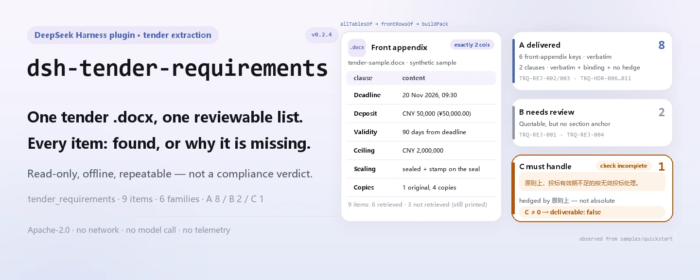

<div align="center">

<picture>
  <source media="(prefers-color-scheme: dark)" srcset="docs/assets/dsh-tender-requirements-hero-en-dark.webp">
  
</picture>

# dsh-tender-requirements

**Transforma um caderno de encargos numa lista de pontos revisável: cada item diz o que foi recuperado e o que falta.**

Um extrator local para responsáveis de proposta e agentes de licitação: lê o anexo inicial e o corpo de um `.docx`, reporta prazo, garantia, validade, teto, composição da proposta e número de originais e cópias, e empacota tudo nas filas entregue / a confirmar / a resolver.

[Instalar](#instalação-em-três-passos) · [Configuração](#configuração) · [FAQ](#faq) · [简体中文](README.md) · [English](README.en.md) · [Español](README.es.md) · [Português](README.pt.md) · [हिन्दी](README.hi.md)

[](LICENSE)
[](#compatibilidade)
[](https://www.npmjs.com/package/dsh-tender-requirements)
[](https://github.com/PerryLink/dsh-tender-requirements/actions/workflows/ci.yml)
[](#compatibilidade)

[](https://github.com/PerryLink/dsh-tender-requirements/stargazers)
[](https://www.npmjs.com/package/dsh-tender-requirements)
[](https://dshfind.com/plugins/PerryLink/dsh-tender-requirements?ref=badge)
[](https://securityscorecards.dev/viewer/?uri=github.com/PerryLink/dsh-tender-requirements)

```sh
dsh plugin --profile <name> add dsh-tender-requirements
```

</div>

<sub>Plugin da comunidade, sem afiliação com a DeepSeek. Repositório canônico: <https://github.com/PerryLink/dsh-tender-requirements>.</sub>

## O que é

`dsh-tender-requirements` é um extrator local somente de leitura, não um revisor. Ele abre o `.docx` que você entrega, emparelha as linhas de um anexo inicial de duas colunas, procura depois a lista de composição da proposta e o número de cópias no corpo e, por fim, emite um relatório com procedência, confiança e motivo para cada item. Itens não encontrados também são impressos, e dizem «não recuperado» em vez de «o caderno não diz». Sem chamada ao modelo, sem rede e sem uma segunda cópia dos dados.

<picture>
  <source media="(prefers-color-scheme: dark)" srcset="docs/assets/dsh-tender-requirements-flow-v5-dark.svg">
  
</picture>

## Instalação em três passos

1. **Instale** (canal npm; git e tarball também funcionam):

   ```sh
   # canal npm (0.2.4 publicada)
   dsh plugin --profile web add dsh-tender-requirements
   # canal git (main mais recente)
   dsh plugin --profile web add github:PerryLink/dsh-tender-requirements
   # canal tarball: após pnpm pack neste repositório
   dsh plugin --profile web add ./dsh-tender-requirements-0.2.4.tgz
   ```

   O perfil insere uma linha `dsh-tender-requirements` via `cordis.patch.yml`; a ferramenta se chama `tender_requirements`.

2. **Configuração mínima** (os padrões funcionam; só o orçamento de tempo precisa de ajuste):

   ```yaml
   - insert:
       - id: dsh-tender-requirements
         name: dsh-tender-requirements
         config:
           timeoutMs: 120000
   ```

3. **Verifique que monta**:

   ```sh
   dsh --profile web --dump-config | grep 'dsh-tender-requirements'
   pnpm run build && node samples/quickstart/run.mjs --check
   ```

   ```
   tender_requirements: quickstart OK — output matches expected/result.json
   ```

   Numa sessão, você também pode chamar `tender_requirements` com `file` apontando para um `.docx`.

**Desinstalar**: `dsh plugin --profile web remove dsh-tender-requirements` (ou remova a linha do patch do perfil).

## Capacidades principais

Separa a extração do julgamento: cada resultado é o que o documento diz, nunca um veredito de conformidade.

As cláusulas de rejeição não dependem de uma única tabela de palavras-chave: a comparação controlada da especificação mostrou que uma lista só de palavras de resultado (como «inválida» ou «rejeitada») acertou 12/24 em dados construídos, com dois falsos positivos, enquanto uma lista só de palavras-gatilho (como «não deve», «deverá» ou «deve») acertou 15/24, e mais da metade eram obrigações do próprio comprador. Por isso o reconhecimento é dividido em seis famílias de redação.

- **Nove itens, todos reportados** — prazo de entrega, abertura, garantia, validade da proposta, teto, número de cópias, requisitos de selagem, visita ao local e prazo de esclarecimentos. Cada um traz `value`, `source`, `confidence` e `reason`; uma falha também deixa uma linha com o motivo.
- **Anexo inicial de duas colunas primeiro** — só uma tabela com exatamente duas colunas é tratada como anexo inicial; um acerto chave/valor ali ganha confiança alta. Um acerto por palavra-chave no corpo cai para média e avisa que a redação pode não ser a final.
- **Lista de composição e número de cópias** — as entradas são lidas após uma frase-guia como «composição do documento da proposta», precisam ser numeradas em sequência e somar pelo menos três; o número de cópias aceita numerais chineses e arábicos, inclusive a forma escrita separada por vírgulas que um regex de dígitos não pega.
- **RequirementsPack com três filas** — as cláusulas de rejeição são agrupadas em seis famílias (`refuse` / `invalid` / `reject` / `disqualify` / `deviation` / `postAward`) e distribuídas em A entregue, B a confirmar e C a resolver; enquanto C não estiver vazia, `deliverable: false` e o relatório diz que a verificação está incompleta.
- **Rede de cobertura de dez tópicos** — COV-01…COV-10 informam acerto ou não recuperado; uma falha não prova que o caderno omita o tópico.
- **Local e repetível** — sem chamada ao modelo, sem rede e sem telemetria; o mesmo `.docx` gera sempre o mesmo resultado.

### Superfície da ferramenta e do resultado

| Superfície | Significado |
|---|---|
| Ferramenta `tender_requirements` | Única entrada; `file` é um caminho absoluto para um `.docx` |
| `mode: requirements` | Padrão; devolve o pacote de três filas, markdown e JSON legível por máquina |
| `mode: extract` | Devolve apenas o anexo inicial e a lista de composição, sem filas |
| `markdown` | Relatório para uma pessoa ou um modelo ler |
| `resultJson` / `requirementsPack` | Extração / RequirementsPack legíveis por máquina |

### Exemplos

A saída abaixo vem da amostra sintética do repositório; rode `pnpm run build` e depois `node samples/quickstart/run.mjs`.

```text
$ node samples/quickstart/run.mjs
tender_requirements: 6 found, 3 missing, 6 composition item(s) — deliverable false
queues: a=8 b=2 c=1
```

*Observed from `samples/quickstart/run.mjs`; `docs/assets/quickstart.log`; `samples/quickstart/expected/result.json`*

`--check` compara esses seis campos byte a byte com `expected/result.json`; `--json` imprime o mesmo resumo como JSON. Há uma captura de terminal em [`docs/assets/quickstart.png`](docs/assets/quickstart.png).

**Ramo de falha** — se o arquivo não for um `.docx` ou não tiver nenhuma tabela legível, a extração falha fechada com um `TenderError` que nomeia o arquivo e diz que o anexo inicial costuma ser uma tabela de duas colunas (`src/model.ts:267`). Se faltar o argumento `file`, falha antes de qualquer leitura com uma mensagem explícita (`src/index.ts:85`).

### Como as três filas se dividem

| Fila | Significado | Condição de entrada |
|---|---|---|
| A entregue | Citado literalmente, numa seção vinculante, sem hedge | Acerto de uma das seis famílias + seção como instruções aos licitantes ou método de avaliação, sem palavra de hedge |
| B a confirmar | A citação existe, mas a evidência estrutural é fraca | Acerto de uma das seis famílias fora de uma seção vinculante |
| C a resolver | Não extraível ou não é afirmação absoluta | Um hedge como «em princípio», «geralmente», «pode», «conforme o caso», «se necessário» ou «a critério», ou ausência de correspondência literal |

`deliverable` só é `true` quando C está vazia; as filas são três forças de evidência, não três prioridades.

## Normas que segue

O pacote não cita cláusulas como base de uma verificação porque extrai, não verifica. O que ele codifica é a estrutura que as cláusulas implicam:

- O artigo 20 das Medidas de Contratação Pública de Bens e Serviços (Portaria 87) enumera os 16 elementos obrigatórios de um caderno, incluindo método, critérios de avaliação e hipóteses de proposta inválida; por isso o anexo inicial é o centro de informação.
- O artigo 23 da Lei das Empreitadas: um esclarecimento, alteração ou ata de perguntas **é parte do caderno**. Este pacote lê apenas o documento principal; essa é a fonte sistemática conhecida de requisitos omitidos.

`rules/tender-requirements.yaml` é o localizador do pacote de regras, e `rules: []` significa que não há regras executáveis; como nada aqui cita uma cláusula como base de um achado, não existe `rules/evidence/`.

## Formato do material

A entrada deve ser um `.docx`. As tabelas são lidas uma candidata por vez via `dsh-table-ingest` — o anexo inicial não é necessariamente a primeira tabela, então pegar só a tabela padrão não basta. Os parágrafos vêm do mesmo leitor e a lista de composição é procurada apenas em parágrafos.

Um anexo inicial é reconhecido como uma tabela com **exatamente duas colunas**. Se o detector de cabeçalho escolheu como cabeçalho um par de dados (a segunda célula parece uma data, um valor ou uma contagem), esse par é recuperado como linha — caso contrário, um prazo declarado se perderia em silêncio.

A ferramenta lê texto e tabelas dentro do `.docx`; não analisa digitalizações nem imagens e não faz OCR. Sem nenhuma tabela legível, lança um `TenderError`.

## Configuração

Há apenas um parâmetro ajustável, o tempo limite da ferramenta; não há chave para arquivo de regras.

| Chave | Padrão | Significado |
|---|---|---|
| `timeoutMs` | `120000` | Orçamento de tempo da ferramenta `tender_requirements` em milissegundos; o host aborta ao esgotar |

<details>
<summary>Tabela de configuração completa (1 chave)</summary>

| Chave | Padrão | Significado |
|---|---|---|
| `timeoutMs` | `120000` | Orçamento de tempo da ferramenta `tender_requirements` em milissegundos; o host aborta ao esgotar |

Não há outros parâmetros; o caminho do pacote de regras é um recurso fixo do pacote, não uma chave de configuração.

</details>

Sobrescrita no patch do perfil:

```yaml
- insert:
    - id: dsh-tender-requirements
      name: dsh-tender-requirements
      config:
        timeoutMs: 300000
```

Sobrescrever por id substitui a linha inteira — repita todas as chaves necessárias.

## FAQ

<details>
<summary>O documento é enviado ou retido?</summary>

Não. O plugin é local e somente de leitura: lê os bytes do `.docx` que você passa, não faz requisições de rede, não chama o modelo e não grava uma segunda cópia. O resultado da ferramenta entra no log de sessão do host DSH (isso é comportamento do host); se o documento tiver informação sensível, gerencie esse log como você já faz.

</details>

<details>
<summary>«Não recuperado» significa que o caderno não contém o item?</summary>

Não. «Não recuperado» só significa que esta execução não encontrou o item numa chave do anexo inicial nem num parágrafo do corpo. Redação diferente, uma célula de tabela ou uma emenda podem passar batido. O relatório pede revisão humana.

</details>

<details>
<summary>O que significa «concluído só quando C está vazia»?</summary>

C contém as cláusulas que a ferramenta não conseguiu extrair ou que não são afirmações absolutas. Enquanto C não estiver vazia, `deliverable` é `false` e o cabeçalho do relatório diz que a verificação está incompleta. Complete C à mão e rode de novo antes de considerar o pacote fechado. Uma lista única fundida deixaria a ferramenta dizer «não há problemas» quando só achou a parte citável — é exatamente isso que as três filas evitam.

</details>

<details>
<summary>Vai conflitar com outros plugins?</summary>

Registra uma única ferramenta com namespace, `tender_requirements`, e injeta apenas `tools`. Não registra chave de serviço, não escuta eventos de sessão, não registra slot de cliente, não registra rota HTTP e não altera objetos globais. `dsh-table-ingest` é usado como biblioteca, não como uma linha extra de plugin.

</details>

<details>
<summary>Um documento grande demora muito?</summary>

Não há chamada ao modelo; o tempo vai para descompactar o `.docx` e ler as tabelas uma a uma, e `dsh-table-ingest` tem orçamentos de número de entradas e de saída. O tempo limite padrão é 120 segundos e pode ser mudado com `timeoutMs`.

</details>

## Resolução de problemas

- **Instala, mas a ferramenta não aparece**: confira se `main` resolve para `lib/index.mjs` e se `pnpm run build` gerou `lib/` (a saída de build não é versionada).
- **`dsh plugin add` recusa o pacote**: a linha do host precisa estar em `>=0.2.1-0 <0.3.0`; fora dessa faixa, conceda uma isenção explícita em vez de forçar um núcleo antigo.
- **Um item nunca é extraído**: veja se a entrada correspondente em `coverage.topics` tem `hit: false` e leia `notes`; se for o anexo inicial, confirme que é uma tabela de exatamente duas colunas.
- **Reporta que não há tabela legível**: o arquivo pode não ser um `.docx` ou o anexo inicial pode não ser uma tabela; esta ferramenta não faz OCR de digitalizações.
- **O antigo array `skipped`**: pertence à família de verificadores de regras; este pacote é um extrator e não produz `skipped`; a informação equivalente está em `coverage.topics` e `notes`.

## Limites de segurança

- **Somente leitura e offline.** Lê apenas o `.docx` recebido, não faz requisições de rede, não chama o modelo e não grava dados fora do pacote; não há telemetria, analytics ou relatórios em segundo plano.
- **Extrair não é julgar.** A saída diz «o documento afirma isto», não «isto é juridicamente válido» nem «esta proposta vai ganhar»; não julga conformidade nem responsabilidade.
- **Não recuperado não significa ausente.** Cada falha leva um motivo; o relatório nunca transforma uma lacuna em conclusão negativa.
- **Falha fechada.** Sem tabela legível, lança erro em vez de devolver um sucesso vazio; se não conseguir ler parágrafos, avisa que só houve extração de tabelas.
- **Limite do log de sessão.** Os valores retornados (incluindo citações e caminhos) entram no armazenamento de sessão/log do host DSH; este pacote não adiciona uma cópia, mas também não controla a retenção do host.

## Permissões e dados

- **Permissões**: `dsh.capabilities` declara apenas `tools:register`; o plugin lê o `.docx` indicado e entrega o resultado ao host.
- **Dados**: não grava um segundo arquivo, não cria banco de dados e não faz requisições de rede; desinstalar remove apenas código e não apaga logs de sessão do host nem documentos que você já criou.
- **Privacidade**: a declaração em `PRIVACY.md` cobre o pacote npm, não o host DSH nem outros plugins do perfil.

## Limitações conhecidas

- **Somente o documento principal.** Esclarecimentos, alterações, aditivos e atas de perguntas são parte do caderno por lei (Lei das Empreitadas, artigo 23) e esta ferramenta não os funde; una-os à mão antes de julgar. É a maior fonte sistemática de requisitos omitidos.
- **O anexo inicial precisa ser uma tabela de duas colunas.** Anexos de três colunas, com células mescladas ou em imagem não são reconhecidos; os valores-chave caem então em acertos no corpo (confiança média) ou em «não recuperado».
- **A lista de composição tem requisitos estruturais.** Precisa começar após uma frase-guia como «composição do documento da proposta» e conter pelo menos três entradas numeradas em sequência; um salto de numeração encerra a lista.
- **O número de cópias só casa com os rótulos chineses de original e cópia, seguidos de um número e da palavra de medida.** Numerais chineses e arábicos funcionam, mas abreviações como «um original, quatro cópias» noutra forma não são analisadas; quando nenhuma das duas contagens é analisada, o relatório pede conferência manual.
- **Cláusulas de rejeição são procuradas apenas em parágrafos do corpo.** Redação fora das seis famílias (`refuse` / `invalid` / `reject` / `disqualify` / `deviation` / `postAward`) não é classificada; uma cláusula de rejeição escrita numa tabela também não entra nas filas.
- **A rede de cobertura é por palavra-chave.** COV-01…COV-10 só dizem se foi encontrada redação relacionada; não é uma verificação de integridade jurídica e cada falha exige confirmação humana.
- **Um acerto no corpo pega o primeiro parágrafo.** Se uma palavra-chave aparece em vários parágrafos, a primeira ocorrência é cortada em 200 caracteres e pode não ser a redação final.
- **Não processa digitalizações.** A entrada precisa ser um `.docx` com texto ou tabelas; PDF, imagens e OCR ficam fora do escopo.
- **Sem diretório de evidências.** Nada aqui cita uma cláusula como base de um achado, então `rules/evidence/` não é mantido; `rules: []` em `rules/tender-requirements.yaml` é intencional.

## Interoperabilidade com outros plugins DSH

Verificado contra o contrato de plugin e a superfície de dependências deste repositório; a conclusão é que ele não ocupa nenhuma das superfícies compartilhadas por outros plugins:

- **Sem conflito de nome de ferramenta.** Registra apenas `tender_requirements`, um nome do namespace deste pacote, e não toma nenhum nome nu de ferramenta embutida.
- **Sem conflito de chave de serviço.** Não fornece serviço e apenas consome `tools`.
- **Sem escuta de eventos.** Não assina eventos de sessão como `agent/*` ou `tools/*`, então não há ordem de listeners nem curto-circuito.
- **Sem slot ou rota HTTP.** Não tem metade de navegador, não registra slot de cliente nem prefixo `webServer`.
- **Sem reescrita global.** Não toca protótipos, `process.env` ou objetos globais; `dsh-table-ingest` é importado como biblioteca.
- **Fronteira do patch.** `cordis.patch.yml` apenas `insert`a a própria linha e nunca sobrescreve o `config` de outra linha.

Evidência estática: `pnpm run verify:self-contained` e `pnpm run check:lockfile` rodam no CI; as especificações de dependência vêm do registro.

## Compatibilidade

| Dimensão | Estado |
|---|---|
| Harness | `>=0.2.1-0 <0.3.0` (`engines.dsh` do package.json); o peer `@deepseek-ai/dsh-tools` cobre `>=0.1.2-rc.1 <0.2.0 \|\| >=0.2.0-0 <0.3.0` |
| Node | `^22.19.0 \|\| >=24.0.0` |
| Plataformas | onde o DSH rodar (ESM puro; sem código nativo, sem rede, sem chamada ao modelo) |
| Modelo | não exige capacidade de modelo; a extração é totalmente local |
| Entrada | `.docx` (texto e tabelas; sem OCR) |

## Ecossistema e qualidade

- [Pacote npm](https://www.npmjs.com/package/dsh-tender-requirements) (0.2.4)
- [Página no dshfind](https://dshfind.com/plugins/PerryLink/dsh-tender-requirements) (instalações e ranking)
- [Relatório OpenSSF Scorecard](https://securityscorecards.dev/viewer/?uri=github.com/PerryLink/dsh-tender-requirements) (movido por [.github/workflows/scorecard.yml](.github/workflows/scorecard.yml))
- **Portões de qualidade**: `typecheck` · `vitest` (extração, filas, semântica de limites e sincronia de versão) · `verify:self-contained` · `check:lockfile` · `check:readmes` · `check:citations`, todos no CI
- **Amostra sintética**: `samples/quickstart/` traz o `.docx` de entrada, o resultado esperado e um script repetível

## Desenvolvimento

```sh
pnpm install
pnpm run typecheck
pnpm test
pnpm run build
pnpm run verify:self-contained
pnpm run check:lockfile
pnpm run check:readmes
pnpm run check:citations
pnpm pack
node samples/quickstart/run.mjs --check   # após build
```

Estrutura de diretórios:

| Caminho | Conteúdo |
|---|---|
| `src/index.ts` | Entrada do plugin: registra a ferramenta `tender_requirements`, lê o `.docx`, monta o resultado |
| `src/model.ts` | Núcleo de extração: anexo inicial, nove itens, lista de composição, cópias, cobertura |
| `src/requirements.ts` | RequirementsPack: seis famílias de rejeição, filas A/B/C, rede de dez tópicos |
| `src/report.ts` / `src/pack-report.ts` | Markdown legível por pessoas |
| `src/config.ts` | Configuração Schemastery (`timeoutMs`) |
| `src/shared/` | Kit compartilhado da família (copiado, não uma dependência extra) |
| `rules/tender-requirements.yaml` | Localizador do pacote de regras (`rules: []`) |
| `samples/quickstart/` | Amostra sintética repetível |
| `tests/` | Suítes vitest e o fixture `.docx` |
| `scripts/` | Portões mecânicos e gerador de imagens |

As imagens são geradas programaticamente por [`scripts/gen-readme-assets.py`](scripts/gen-readme-assets.py): Python + Pillow para os hero WebP claro/escuro e SVG estruturais escritos à mão (os nomes começam por `dsh-tender-requirements-`). Rode de novo com `python scripts/gen-readme-assets.py`.

Sincronia de código compartilhado: `src/shared/` é copiado do kit compartilhado da família; dentro do workspace da família pode ser atualizado com `node ../scripts/sync-shared.mjs dsh-tender-requirements` (esse script não existe num clone independente).

Tópicos: `dsh`, `dsh-plugin`, `deepseek-harness`, `deepseek`, `cordis`, `tender`, `extraction`, `bid`, `requirements`

## Família e agradecimentos

Este projeto é membro da família de plugins do DeepSeek Harness mantida por [PerryLink](https://github.com/PerryLink) (todos Apache-2.0). Índice completo da família: [escolha um verificador por material](https://perrylink.github.io/zh/checkers/choose/); todos os plugins estão na tabela abaixo. Se ajudou, **deixe uma estrela** — não desbloqueia nada, mas faz a próxima pessoa encontrar mais fácil.

- [@PerryLink](https://github.com/PerryLink) — criador e mantenedor: o extrator, o RequirementsPack de três filas, a rede de dez tópicos e a documentação em cinco idiomas.

<details>
<summary>Expandir todos os plugins</summary>

| Plugin | Estado |
|---|---|
| **[dsh-aqua-input-check](https://github.com/PerryLink/dsh-aqua-input-check)** |  |
| **[dsh-archive-check](https://github.com/PerryLink/dsh-archive-check)** |  |
| **[dsh-auto-review](https://github.com/PerryLink/dsh-auto-review)** |  |
| **[dsh-autotier](https://github.com/PerryLink/dsh-autotier)** | 🧊 CONGELADO — ver o README do repo |
| **[dsh-bid-ca-precheck](https://github.com/PerryLink/dsh-bid-ca-precheck)** |  |
| **[dsh-bid-qual-check](https://github.com/PerryLink/dsh-bid-qual-check)** |  |
| **[dsh-cert-mcp](https://github.com/PerryLink/dsh-cert-mcp)** | 🧊 CONGELADO — ver o README do repo |
| **[dsh-checkpoint-rewind](https://github.com/PerryLink/dsh-checkpoint-rewind)** |  |
| **[dsh-click](https://github.com/PerryLink/dsh-click)** |  |
| **[dsh-composer-history](https://github.com/PerryLink/dsh-composer-history)** |  |
| **[dsh-contract-stance](https://github.com/PerryLink/dsh-contract-stance)** |  |
| **[dsh-customs-doc-check](https://github.com/PerryLink/dsh-customs-doc-check)** |  |
| **[dsh-data-quality](https://github.com/PerryLink/dsh-data-quality)** | 🧊 CONGELADO — ver o README do repo |
| **[dsh-demurrage-ledger](https://github.com/PerryLink/dsh-demurrage-ledger)** |  |
| **[dsh-doublecheck](https://github.com/PerryLink/dsh-doublecheck)** |  |
| **[dsh-drill-script-check](https://github.com/PerryLink/dsh-drill-script-check)** |  |
| **[dsh-eia-guide-check](https://github.com/PerryLink/dsh-eia-guide-check)** |  |
| **[dsh-emergency-plan](https://github.com/PerryLink/dsh-emergency-plan)** |  |
| **[dsh-essay-rubric-check](https://github.com/PerryLink/dsh-essay-rubric-check)** |  |
| **[dsh-evidence-check](https://github.com/PerryLink/dsh-evidence-check)** |  |
| **[dsh-export-ctl-check](https://github.com/PerryLink/dsh-export-ctl-check)** |  |
| **[dsh-fast](https://github.com/PerryLink/dsh-fast)** |  |
| **[dsh-fmea-table-check](https://github.com/PerryLink/dsh-fmea-table-check)** |  |
| **[dsh-forecast-penalty](https://github.com/PerryLink/dsh-forecast-penalty)** |  |
| **[dsh-fund-research](https://github.com/PerryLink/dsh-fund-research)** |  |
| **[dsh-github](https://github.com/PerryLink/dsh-github)** |  |
| **[dsh-gongwen-flow-check](https://github.com/PerryLink/dsh-gongwen-flow-check)** |  |
| **[dsh-gongwen-word-check](https://github.com/PerryLink/dsh-gongwen-word-check)** |  |
| **[dsh-guard-plan-qc](https://github.com/PerryLink/dsh-guard-plan-qc)** |  |
| **[dsh-hazchem-check](https://github.com/PerryLink/dsh-hazchem-check)** |  |
| **[dsh-hazplan-check](https://github.com/PerryLink/dsh-hazplan-check)** |  |
| **[dsh-hidden-risk-map](https://github.com/PerryLink/dsh-hidden-risk-map)** |  |
| **[dsh-hs-classify](https://github.com/PerryLink/dsh-hs-classify)** |  |
| **[dsh-icd-rule-check](https://github.com/PerryLink/dsh-icd-rule-check)** |  |
| **[dsh-industry-research](https://github.com/PerryLink/dsh-industry-research)** |  |
| **[dsh-lawcite-adapter](https://github.com/PerryLink/dsh-lawcite-adapter)** |  |
| **[dsh-laya](https://github.com/PerryLink/dsh-laya)** |  |
| **[dsh-lc-doc-check](https://github.com/PerryLink/dsh-lc-doc-check)** |  |
| **[dsh-learning-gap-check](https://github.com/PerryLink/dsh-learning-gap-check)** |  |
| **[dsh-library](https://github.com/PerryLink/dsh-library)** |  |
| **[dsh-local-ai](https://github.com/PerryLink/dsh-local-ai)** |  |
| **[dsh-lsp-actions](https://github.com/PerryLink/dsh-lsp-actions)** |  |
| **[dsh-mask](https://github.com/PerryLink/dsh-mask)** |  |
| **[dsh-mcp-panel](https://github.com/PerryLink/dsh-mcp-panel)** |  |
| **[dsh-medrec-qc](https://github.com/PerryLink/dsh-medrec-qc)** |  |
| **[dsh-memento](https://github.com/PerryLink/dsh-memento)** | 🧊 CONGELADO — ver o README do repo |
| **[dsh-nsfc-form-check](https://github.com/PerryLink/dsh-nsfc-form-check)** |  |
| **[dsh-nurse-record-check](https://github.com/PerryLink/dsh-nurse-record-check)** |  |
| **[dsh-observe](https://github.com/PerryLink/dsh-observe)** |  |
| **[dsh-origin-rvc-check](https://github.com/PerryLink/dsh-origin-rvc-check)** |  |
| **[dsh-ota-review-check](https://github.com/PerryLink/dsh-ota-review-check)** |  |
| **[dsh-output-styles](https://github.com/PerryLink/dsh-output-styles)** |  |
| **[dsh-paper-doc-adapter](https://github.com/PerryLink/dsh-paper-doc-adapter)** |  |
| **[dsh-permission-rules](https://github.com/PerryLink/dsh-permission-rules)** |  |
| **[dsh-permit-report-check](https://github.com/PerryLink/dsh-permit-report-check)** |  |
| **[dsh-pipeline-check](https://github.com/PerryLink/dsh-pipeline-check)** |  |
| **[dsh-pleading-draft](https://github.com/PerryLink/dsh-pleading-draft)** |  |
| **[dsh-plugin-doctor](https://github.com/PerryLink/dsh-plugin-doctor)** | 🚫 APOSENTADO (repo arquivado) |
| **[dsh-plugin-guide](https://github.com/PerryLink/dsh-plugin-guide)** |  |
| **[dsh-plugin-kit](https://github.com/PerryLink/dsh-plugin-kit)** | 🚫 APOSENTADO (repo arquivado) |
| **[dsh-plugin-upgrade](https://github.com/PerryLink/dsh-plugin-upgrade)** | 🚫 APOSENTADO (repo arquivado) |
| **[dsh-policy-brief-draft](https://github.com/PerryLink/dsh-policy-brief-draft)** |  |
| **[dsh-power-loss-split](https://github.com/PerryLink/dsh-power-loss-split)** |  |
| **[dsh-power-ticket-check](https://github.com/PerryLink/dsh-power-ticket-check)** |  |
| **[dsh-ppap-check](https://github.com/PerryLink/dsh-ppap-check)** |  |
| **[dsh-protest-deadline](https://github.com/PerryLink/dsh-protest-deadline)** |  |
| **[dsh-railway-window](https://github.com/PerryLink/dsh-railway-window)** |  |
| **[dsh-repair-order-qc](https://github.com/PerryLink/dsh-repair-order-qc)** |  |
| **[dsh-research-report](https://github.com/PerryLink/dsh-research-report)** |  |
| **[dsh-review-reply-check](https://github.com/PerryLink/dsh-review-reply-check)** |  |
| **[dsh-rulefile-check](https://github.com/PerryLink/dsh-rulefile-check)** |  |
| **[dsh-safety-brief-check](https://github.com/PerryLink/dsh-safety-brief-check)** |  |
| **[dsh-score](https://github.com/PerryLink/dsh-score)** | 🧊 CONGELADO — ver o README do repo |
| **[dsh-session-sync](https://github.com/PerryLink/dsh-session-sync)** |  |
| **[dsh-site-log-check](https://github.com/PerryLink/dsh-site-log-check)** |  |
| **[dsh-skill-pack-security](https://github.com/PerryLink/dsh-skill-pack-security)** |  |
| **[dsh-soe-decision-check](https://github.com/PerryLink/dsh-soe-decision-check)** |  |
| **[dsh-soilwater-check](https://github.com/PerryLink/dsh-soilwater-check)** |  |
| **[dsh-sop-sync-check](https://github.com/PerryLink/dsh-sop-sync-check)** |  |
| **[dsh-spc-gbt-adapter](https://github.com/PerryLink/dsh-spc-gbt-adapter)** |  |
| **[dsh-talk](https://github.com/PerryLink/dsh-talk)** |  |
| **[dsh-tender-extract](https://github.com/PerryLink/dsh-tender-extract)** |  |
| **[dsh-tender-matrix](https://github.com/PerryLink/dsh-tender-matrix)** |  |
| **[dsh-test-drive](https://github.com/PerryLink/dsh-test-drive)** |  |
| **[dsh-ticktick](https://github.com/PerryLink/dsh-ticktick)** | 🚫 APOSENTADO (repo arquivado) |
| **[dsh-translate](https://github.com/PerryLink/dsh-translate)** |  |
| **[dsh-warranty-calc](https://github.com/PerryLink/dsh-warranty-calc)** |  |
| **[dsh-budget](https://github.com/PerryLink/dsh-budget)** | 🧊 CONGELADO — ver o README do repo |
| **[dsh-claude-move](https://github.com/PerryLink/dsh-claude-move)** | 🧊 CONGELADO — ver o README do repo |
| **[dsh-defend](https://github.com/PerryLink/dsh-defend)** | 🧊 CONGELADO — ver o README do repo |
| **[dsh-draw](https://github.com/PerryLink/dsh-draw)** | 🧊 CONGELADO — ver o README do repo |
| **[dsh-reach](https://github.com/PerryLink/dsh-reach)** | 🧊 CONGELADO — ver o README do repo |
| **[dsh-background-agents](https://github.com/PerryLink/dsh-background-agents)** | 🚫 APOSENTADO (repo arquivado) |
| **[dsh-session-pin](https://github.com/PerryLink/dsh-session-pin)** | 🚫 APOSENTADO (repo arquivado) |
| **[dsh-team-rooms](https://github.com/PerryLink/dsh-team-rooms)** | 🚫 APOSENTADO (repo arquivado) |

</details>

## Licença

[LICENSE](LICENSE) (Apache License 2.0) © 2026 dsh-tender-requirements contributors

<p align="center"><sub>Apache-2.0 · Plugin da comunidade, sem afiliação com a DeepSeek.</sub></p>
